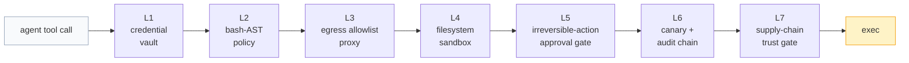

# loadn

<picture>
  <source media="(prefers-color-scheme: dark)" srcset="docs/assets/logo-dark.svg">
  
</picture>

[](https://github.com/loadn-ai/loadn/actions/workflows/ci.yml)
[](https://github.com/loadn-ai/loadn/releases)
[](LICENSE)
[](pyproject.toml)
[](https://github.com/astral-sh/ruff)

**[简体中文](README.zh-CN.md)** | English

> ### 天行健，oldman，地势坤，loadn。
>
> *As heaven moves with vigor, the oldman strives without rest; as earth lies
> receptive, loadn bears and carries all.* — the project motto, after the
> Qian and Kun hexagrams of the *I Ching*.

**A self-contained coding-agent engine in pure Python, grown into a
self-hostable agent platform.** One `pip install`, any Anthropic-form or
OpenAI-compatible endpoint, and you get a headless agent with tools, MCP,
subagents, session persistence, and context compaction — speaking the Claude
Code `stream-json` dialect, so existing harnesses can drive it as a drop-in
subprocess engine. Around the engine sits a multi-session web platform:
organization of digital employees, a resource hub, a seven-layer
execution-security stack, scheduling, cost accounting, and a tamper-evident
audit ledger.

> **Status:** `v0.7.x` (beta), actively maintained. The CLI argv contract,
> `stream-json` dialect, and config keys follow SemVer; breaking changes are
> announced in [CHANGELOG.md](CHANGELOG.md) with each minor bump.
>
> Naming: loadn is the engine package of the loadn-ai platform (org:
> **loadn-ai**). Product forms: `loadn` engine / `loadn-web` platform /
> `loadn desktop`.

## The workbench

Sessions, live agent process (thinking / tool cards / subagent dispatch /
steering), queued messages, artifacts — one screen:


Highlights visible in the shot: the **task checklist** synced from
`TodoWrite`/`TaskCreate` events, **collapsible thinking cards** (per-agent
attribution, live character counts for subagent thinking), the **dispatch
card** when a task is delegated to a named digital employee, **steering
notes** (mid-run interjections that inject before the next LLM call), and
markdown replies with GFM tables. Reloaded sessions replay byte-identically
with the live stream — same components, same order, nothing lost.

---

## Three original formulas

The platform is built as the deployed form of three original ideas. Each
formula names the terms; each screenshot is the formula running in
production.

### 1 · Agent = Model + Harness + Resource

An agent is not a model. A model is rented; the **harness** is the
engineering discipline around it (loop control, permission engine, context
compaction, subagent management, event dialect), and **resources** are what
the world will actually admit the agent to use: endpoints, credentials,
sensors, egress paths, headless browsers. loadn makes each term explicit and
swappable — the model layer is provider-agnostic (any Anthropic-form or
OpenAI-compatible endpoint), the harness is the engine you are reading
about, and resources are first-class citizens managed in the **Resource
Hub**:


Every resource is defined as a `Resource.md` (structured form ↔ markdown
source, two-way live sync), binds credentials from the encrypted vault by
reference, and injects into the task environment as `LOADN_SVC_*` variables
— the harness preview shows exactly what the agent will see:


### 2 · Digital Employee = Agent + Skills + Memory

The platform runs an **organization**, not a single agent. Department trees
and named employees are defined in the org console (each employee is an
agent definition: MBTI-flavored persona, skills, duty — hot-injected into
the subagent registry); **skills** are agentskills.io-standard `SKILL.md`
packages taught over time (the skill-suggestion loop turns your corrections
into persistent, reviewable skills); **memory** is partitioned into user /
project / workspace scopes with snapshot-and-rollback:


Dispatch is by name: `Task(subagent_type="小明")` routes work to employee
小明 with her persona and skill set; results, thinking, and files flow back
attributed. Temporary workers can be recruited from a pool for burst work —
the org stays legible while the headcount flexes.

### 3 · Security = Sandbox + Control Points + Vault + Audit

Security is not a checkbox; it is **four terms multiplied together**. The
**sandbox** fences reversible work (bwrap binds + netns, egress only through
the allowlist proxy); **control points** gate the irreversible (bash-AST
policy, egress three-state policy, approval gates with one-time codes bound
to parameter hashes); the **vault** keeps every credential AES-GCM encrypted
with plaintext never entering the agent environment; and the **audit**
ledger chains every adjudication hash-by-hash with daily external anchors.
No LLM sits on the enforcement path — every layer is deterministic,
fail-closed:




| # | Term | Mechanism | Source |
|---|---|---|---|
| L1 | Vault | AES-GCM; plaintext never enters the agent env | `loadn_webui/security/vault.py` |
| L2 | Control point | Bash AST policy: L0 red lines + token-coverage rules, out-of-process PreToolUse | `loadn_webui/security/policy.py` |
| L3 | Control point | Egress allowlist proxy; CONNECT allowlist, DNS-rebinding & private-net rejection | `loadn_webui/security/egress_proxy.py` |
| L4 | Sandbox | bwrap same-path binds; netns with proxy socket as sole egress | `loadn_webui/security/sandbox.py` |
| L5 | Control point | Irreversible-action approval gate: one-time codes bound to parameter hashes | `loadn_webui/security/approve.py` |
| L6 | Audit | Canary trips + hash-chained ledger with daily anchors | `loadn_webui/security/canary.py` · `audit.py` |
| L7 | Control point | Supply-chain trust gate: skill sha256 locks, eight-class static scans | `loadn_webui/security/skill_scan.py` |

---

## Architecture


## Monorepo: engine + platform

This repo is more than the engine — a fully self-hostable **multi-session
agent platform**:

| Component | What it is | Start |
|---|---|---|
| `loadn/` | The engine (main subject of this README) | `pip install loadn` |
| `loadn_webui/` | Web platform: sessions / org / resource hub / security / scheduling / cost, with the seven-layer execution-security stack above | `pip install -e ".[webui]"` → `loadn-web init` → `loadn-web serve` |
| `desktop/` | Desktop form (Tauri shell + Debian rootfs: the whole execution domain runs inside a Linux VM on mac/win) | `desktop/image/` build pipeline |
| `ui/` | React frontend (admin center with security / resource / org panels) | `cd ui && npm run build` |


Docs index: [ARCHITECTURE](docs/ARCHITECTURE.md) (planes / data layout /
test system) · [CONFIG](docs/CONFIG.md) (every config key) ·
[EXTENDING](docs/EXTENDING.md) (customization seams: engines / providers /
skills / MCP / hooks) · [PROTOCOL](docs/PROTOCOL.md) (engine dialect
contract) · [RELEASE](docs/RELEASE.md) (deploy / upgrade / rollback) ·
[ATTACK_SURFACE](docs/ATTACK_SURFACE.md) (attack surface + AI-BOM).

## Why another agent engine

- **Embeddable & hackable.** Typed Python 3.10+, one runtime dependency
  (`httpx`). The core loop (`AgentCore.run_turn`) is a library first; the CLI
  is a thin shell around it.
- **Speaks `stream-json` natively.** The CLI's argv contract and event stream
  are deliberately isomorphic to Claude Code's headless mode
  (`-p --verbose --output-format stream-json`, prompt as `argv[-1]`,
  `--session-id`/`--resume`, `system/assistant/user/result` events with
  `usage` + per-model `modelUsage`, plus per-delta `stream_event` lines under
  `--verbose` for typewriter rendering). Harnesses built for the Claude CLI
  can spawn loadn instead — supervision, accounting, and UI keep working.
- **Provider-agnostic.** Works with Anthropic-form gateways (Z.AI GLM,
  Anthropic proper) and any OpenAI-compatible endpoint (DeepSeek, vLLM,
  LiteLLM, ...), with thinking/reasoning and tool-call translation handled in
  one adapter layer.
- **Discipline built in.** Output truncation budgets, read-before-write file
  guards, a two-tier loop-guard that interrupts repeated identical calls
  (soft remind → hard break), dual-signal stall detection for subprocesses,
  and compaction that keeps tool-call pairing intact. Stream interruptions
  and retriable provider errors are retried inside the loop — a turn never
  ends with a bogus success. Oversized prompts (E2BIG) transparently fall
  back to stdin injection.
- **Cheap by default.** Three prompt-cache breakpoints (tools tail / system /
  last message) with a no-cache lane for auxiliary calls, a handoff-style
  compactor that prunes before summarizing (with a file ledger and UPDATE
  mode), a completion gate for grind mode (verbal-delivery interception +
  artifact existence checks), last-call usage accounting, and
  context-overflow self-rescue via forced compaction.
- **Won't die waiting on a shell.** Foreground commands that exceed 60s are
  automatically adopted into the background task table (the agent keeps
  working and `tail`s the log later); interactive programs (REPLs, terminal
  games, install wizards) get a pty-backed `InteractiveShell` tool that
  scripts multi-round send/expect exchanges in a single call.
- **Context engineering.** The system prompt assembles from a CLAUDE.md /
  AGENTS.md ancestor chain (git-root bounded, nearest last, `@import`
  support), a skills index, long-term memory with boundary-driven background
  extraction, and a repo map — mirroring Claude Code's layered memory.
- **Mutation-tested.** 1600+ tests (zero token, fake-provider driven) at 83%
  line coverage — and beyond coverage, a homegrown mutation-testing runner
  has injected **4055 bugs into 47 core files with a 78% kill rate**,
  proving the assertions actually catch regressions, not just execute code
  paths. See [tests/TEST-PLAN.md](tests/TEST-PLAN.md) §7.

## Install

```bash
pip install loadn          # or: pip install git+https://github.com/loadn-ai/loadn
```

No config required — endpoint resolution order:

1. `$LOADN_HOME/config.json` (your overrides)
2. environment: `ANTHROPIC_BASE_URL` / `ANTHROPIC_AUTH_TOKEN` / `LOADN_MODEL`
   / `LOADN_PROVIDER` (`anthropic` | `openai` | `fake`)
3. `~/.claude/settings.json` env block (if you already run the Claude CLI
   against a gateway, loadn reuses it as-is)

## Quickstart

```bash
# one-shot, human-readable
loadn -p --dangerously-skip-permissions "read ./note.txt and summarize it"

# headless event stream (Claude Code stream-json dialect)
loadn -p --verbose --output-format stream-json \
  --session-id 11111111-2222-3333-4444-555555555555 "fix the failing test"

# continue a session / structured result only / interactive REPL
loadn -p --resume 11111111-2222-3333-4444-555555555555 "continue"
loadn -p --output-format json "list the todos"
loadn                       # REPL: /help /resume /fork /compact /todos
```

Event stream shape (NDJSON on stdout, one JSON object per line):

```json
{"type":"system","subtype":"init","session_id":"…","model":"…","tools":[…]}
{"type":"stream_event","event":{"type":"content_block_delta","index":0,"delta":{"type":"text_delta","text":"Let me "}},"parent_tool_use_id":null}
{"type":"assistant","message":{"id":"msg_…","role":"assistant","content":[{"type":"tool_use","id":"tu_1","name":"Bash","input":{"command":"ls"}}]}}
{"type":"user","message":{"role":"user","content":[{"type":"tool_result","tool_use_id":"tu_1","content":"…","is_error":false}]}}
{"type":"result","subtype":"success","usage":{"input_tokens":…,"output_tokens":…,"cache_read_input_tokens":…,"cache_creation_input_tokens":…},"modelUsage":{…},"num_turns":2,"duration_ms":…}
```

`stream_event` lines (Anthropic SSE-shaped deltas, only with `--verbose`) are
best-effort transport for live rendering — the assembled `assistant` event is
always the source of truth. Exit codes: `0` success, `1` any `error_*`
outcome. During long tool runs the CLI emits a `system/heartbeat` line every
30s so parent-process stall detectors don't kill healthy work.

## Use as a library

```python
import asyncio
from pathlib import Path
from loadn.core.build import build_agent

async def main():
    bundle = await build_agent(Path.cwd())          # provider/tools/session wired
    summary = await bundle.core.run_turn("find TODOs and write them to notes/")
    print(summary.text, summary.usage, summary.model_usage)

asyncio.run(main())
```

`AgentCore` is also constructible piecewise (custom tool registry, permission
mode, hooks, compactor off, ...) — see `loadn/core/build.py`.

## Embedding into a harness

Because the CLI mirrors Claude Code's headless contract, any supervisor that
spawns `claude -p --output-format stream-json` can spawn `loadn` instead:

- fresh sessions: `--session-id <uuid>`; continuations: `--resume <uuid>`
- a live session lock rejects concurrent use with the same
  `Session ID already in use` wording (stderr, exit 1)
- accounting: the final `result` event carries snake_case `usage` and
  camelCase per-model `modelUsage` for cost dashboards
- per-session transcripts live under `$LOADN_HOME/sessions/<sid>/`
  (append-only JSONL; replay resumes from the last compaction point)
- long-lived hosting: `loadn daemon` keeps AgentCore alive across
  disconnects (UDS attach), so cache warmth and context survive UI reconnects

## Configuration & extension points

| Thing | Where |
|---|---|
| Engine knobs (thresholds, budgets, limits) | `loadn/constants.py` |
| Permission rules | `.loadn/settings.json` in the project (deny/allow, `Bash:git push*` patterns; `.agent/` legacy path still honored); modes `default/acceptEdits/plan/bypassPermissions` |
| Hooks (Pre/PostToolUse, Stop, Session*) | `.loadn/settings.json` `hooks` — external commands, stdin JSON, exit 2 blocks |
| MCP servers | `.mcp.json` in the project (stdio + streamable-HTTP with OAuth); tools appear as `mcp__<server>__<tool>` |
| Skills | `.agents/skills/` (agentskills.io standard, highest priority) / `.claude/skills/` / `.loadn/skills/` / `$LOADN_HOME/skills` SKILL.md — indexed in the system prompt; body loads on demand via the `Skill` tool (third-party installs go through a supply-chain lock; any skill exports as an agentskills.io-compatible zip) |
| Custom subagents | `.claude/agents/*.md` / `$LOADN_HOME/agents` — frontmatter `name/description/tools/model`; usable as `Task(subagent_type=…)`; org-console employees are hot-injected here |
| Constitution chain | CLAUDE.md/AGENTS.md from the git root down to cwd, nearest last; `@./file.md` line imports; user-level `$LOADN_HOME/AGENT.md` on top |
| Platform config (50+ keys) | [docs/CONFIG.md](docs/CONFIG.md) — sandbox tiers, egress allowlist/three-state policy, approval TTLs, resource bridges |
| Thinking budget | `LOADN_THINKING_BUDGET` env or `extra.thinking_budget` (Anthropic-form `thinking.budget_tokens`; off by default) |
| Prompt caching | on by default (3 breakpoints); `extra.disable_prompt_cache` kills it |

## Testing your changes

```bash
pip install -e ".[dev]"
pytest            # 1600+ tests, zero API calls
ruff check .
```

The fake provider (`LOADN_PROVIDER=fake`) replays control files from
`$LOADN_FAKE_DIR` — the same protocol used by end-to-end CLI tests. Beyond
pytest: 10 eval scenarios gate releases nightly, and
`scripts/mutate.py` measures whether your tests actually kill injected bugs
(contribution rule of thumb in [CLAUDE.md](CLAUDE.md) §测试同步纪律:
new guard logic needs a negative-path test; new modules need an entry in the
mutation TARGET_TESTS map).

## Status & roadmap

- [x] v0.4.x — open-source readiness: portable defaults, engine plugin
      entry point, community files, zero lint debt
- [x] v0.6.0 — per-task isolated workspaces, rotation anchors, crash-recovery
      bookkeeping, provider thinking continuation
- [x] v0.6.3 — interactive egress control: off/warn/enforce + ask-to-approve
      cards, session-level overrides, per-session attribution
- [x] v0.6.5 — every security mechanism explicitly configurable; host
      resource bridges
- [x] post-0.6.5 — test-quality campaign: 83% coverage, mutation
      verification at 47 files / 4055 mutants (78% kill rate), weekly
      mutation gate in CI
- [x] v0.7.x — operational hardening: replay-parity chat (reload identical
      to live), Resource Hub with `Resource.md` two-way editing, digital
      employees (org / duty / temp pool), non-idle upgrade guards, admin
      redesign (see CHANGELOG)
- [ ] PyPI first release (name reserved; tag → build → publish automated)
- [ ] desktop real-device validation (mac/win)
- [ ] docs site (GitHub Pages: README/ARCHITECTURE/CONFIG/EXTENDING)
- [ ] Terminal-Bench baseline numbers
- [ ] Ollama provider, DeepSeek native; TUI (textual)
- [ ] MCP server mode (loadn driven as an MCP server)

See [CHANGELOG.md](CHANGELOG.md) and [ROADMAP.md](ROADMAP.md).
Contributions welcome — [CONTRIBUTING.md](CONTRIBUTING.md) describes the
layout, how to add a tool or provider in one file, and the assertion-strength
rules (negative-path tests for new guards; mutation narrow-set for touched
files).

## License

Apache-2.0 — see [LICENSE](LICENSE).
