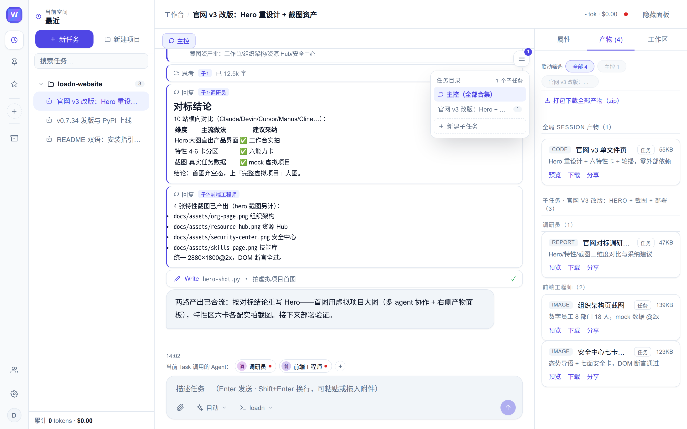
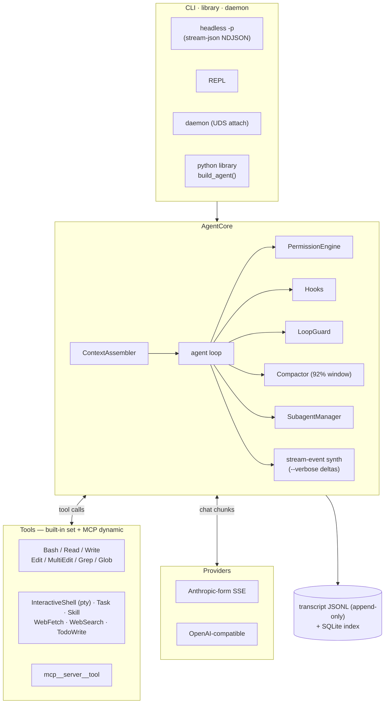
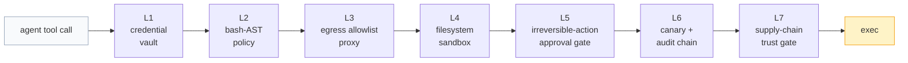

# loadn

<picture>
  <source media="(prefers-color-scheme: dark)" srcset="docs/assets/logo-dark.svg">
  
</picture>

[](https://github.com/loadn-ai/loadn/actions/workflows/ci.yml)
[](https://github.com/loadn-ai/loadn/releases)
[](LICENSE)
[](pyproject.toml)
[](https://github.com/astral-sh/ruff)

English | **[简体中文](README.zh-CN.md)**

> As heaven moves with vigor — OldMan; as earth lies receptive — LoadN.

> **Naming.** loadn (read *load-n*) is the engine package of the loadn-ai
> platform. Product forms: `loadn` engine / `loadn-web` platform /
> `loadn desktop`.

## Introduction

loadn is a self-contained coding-agent engine written in pure Python, grown
into a self-hostable agent platform. One `pip install` plus any
Anthropic-form or OpenAI-compatible endpoint yields a headless agent with
built-in tools, MCP support, subagents, session persistence, and context
compaction. The CLI speaks the Claude Code `stream-json` dialect, so
harnesses built for the Claude CLI can drive loadn as a drop-in subprocess
engine.

The same repository also hosts the platform around the engine: `loadn-web`,
a multi-session web application providing digital-employee organization, a
resource hub, a seven-layer execution-security stack, scheduling, cost
accounting, and a tamper-evident audit ledger.

**Status.** v0.7.x (beta), actively maintained. The CLI argv contract, the
`stream-json` dialect, and configuration keys follow Semantic Versioning;
breaking changes are announced in [CHANGELOG.md](CHANGELOG.md) with every
minor release.

### Repository layout

| Path | Contents | How to start |
|---|---|---|
| `loadn/` | The agent engine (main subject of this document) | `pip install loadn` |
| `loadn_webui/` | Web platform: sessions, organization, resource hub, security, scheduling, cost accounting | `pip install -e ".[webui]"` → `loadn-web init` → `loadn-web serve` |
| `desktop/` | Desktop distribution: Tauri shell with a Debian rootfs; the whole execution domain runs inside a Linux VM on macOS and Windows | `desktop/image/` build pipeline |
| `ui/` | React frontend for the administration center (security, resource, and organization panels) | `cd ui && npm run build` |



### Architecture



## Features

### Agent runtime

- Agent loop with a permission engine, hooks, and a two-tier loop guard
  that interrupts repeated identical tool calls (soft reminder, then hard
  break).
- Context compaction at a 92% window that preserves tool-call pairing;
  stream interruptions and retriable provider errors are retried inside the
  loop, so a turn never ends with a bogus success.
- Session persistence: append-only JSONL transcripts with a SQLite index;
  replay resumes from the last compaction point.
- `loadn daemon` keeps AgentCore alive across disconnects (UDS attach), so
  cache warmth and context survive UI reconnects.
- Long-running work: foreground commands exceeding 60 s are adopted into a
  background task table automatically (the agent keeps working and reads
  the log later); interactive programs (REPLs, install wizards) get a
  pty-backed `InteractiveShell` tool that scripts multi-round
  send/expect exchanges in a single call.

### Tools and extensibility

- Built-in toolset: file editing (Read / Write / Edit / MultiEdit), search
  (Grep / Glob), shell (Bash, InteractiveShell), delegation (Task),
  on-demand knowledge (Skill), web (WebFetch / WebSearch), and task
  tracking (TodoWrite).
- MCP servers declared in `.mcp.json` (stdio and streamable HTTP with
  OAuth); their tools appear as `mcp__<server>__<tool>`.
- Skills follow the agentskills.io `SKILL.md` standard; third-party
  installs pass a supply-chain lock, and any skill exports as a compatible
  zip.
- Custom subagents defined as markdown files with
  `name/description/tools/model` frontmatter, usable through
  `Task(subagent_type=...)`.

### Provider-agnostic model layer

Any Anthropic-form SSE endpoint (Z.AI GLM, Anthropic proper) and any
OpenAI-compatible endpoint (DeepSeek, vLLM, LiteLLM, and others).
Thinking/reasoning content and tool-call syntax are translated in a single
adapter layer.

### Claude Code `stream-json` compatibility

- The argv contract and event stream are deliberately isomorphic to Claude
  Code's headless mode (`-p --verbose --output-format stream-json`,
  prompt as `argv[-1]`, `--session-id` / `--resume`, and
  `system/assistant/user/result` events).
- The final `result` event carries snake_case `usage` plus camelCase
  per-model `modelUsage`, ready for cost dashboards.
- During long tool runs the CLI emits a `system/heartbeat` line every 30 s,
  so parent-process stall detectors do not kill healthy work.
- The live session lock reproduces the `Session ID already in use` error
  (stderr, exit 1) that supervisors match on.

### Context engineering

The system prompt assembles from a CLAUDE.md / AGENTS.md ancestor chain
(git-root bounded, nearest last, `@import` support), a skills index,
long-term memory with boundary-driven background extraction, and a
repository map — mirroring Claude Code's layered memory.

### Cost discipline

Three prompt-cache breakpoints (tools tail / system / last message) with a
no-cache lane for auxiliary calls; a handoff-style compactor that prunes
before summarizing (file ledger and UPDATE mode); a completion gate for
grind mode (verbal-delivery interception plus artifact existence checks);
last-call usage accounting; and context-overflow self-rescue via forced
compaction.

### Platform (`loadn-web`)


- Multi-session workbench: live agent process with thinking cards, tool
  cards, subagent dispatch, steering notes, and queued messages. Reloaded
  sessions replay byte-identically with the live stream.
- Digital employees: department trees and named employees, each an agent
  definition (persona, skills, duty) hot-injected into the subagent
  registry. Dispatch is by name — `Task(subagent_type="xiaoming")` routes
  work with that employee's persona and skill set; a temporary-worker pool
  absorbs burst work.
- Skills library: local and marketplace skills with source badges and
  lifecycle states; a suggestion loop turns your corrections into
  persistent, reviewable skills.
- Resource Hub: every resource is a `Resource.md` with two-way editing
  between a structured form and markdown source; credentials bind from the
  encrypted vault by reference and inject into the task environment as
  `LOADN_SVC_*` variables, with a preview of exactly what the agent will
  see.
- Scheduling, cost accounting, and a hash-chained audit ledger with daily
  external anchors.

Screenshots: organization console (`docs/assets/org-page.png`), skills
library (`docs/assets/skills-page.png`), resource hub
(`docs/assets/resource-hub.png`), resource drawer with injection preview
(`docs/assets/resource-drawer.png`).

### Execution security

Security is treated as four multiplied terms: sandbox, control points,
vault, and audit. No LLM sits on the enforcement path; every layer is
deterministic and fail-closed.




| Layer | Term | Mechanism | Source |
|---|---|---|---|
| L1 | Vault | AES-GCM encryption; plaintext never enters the agent environment | `loadn_webui/security/vault.py` |
| L2 | Control point | Bash AST policy: red lines plus token-coverage rules, out-of-process PreToolUse | `loadn_webui/security/policy.py` |
| L3 | Control point | Egress allowlist proxy; CONNECT allowlist, DNS-rebinding and private-net rejection | `loadn_webui/security/egress_proxy.py` |
| L4 | Sandbox | bwrap same-path binds; network namespace with the proxy socket as sole egress | `loadn_webui/security/sandbox.py` |
| L5 | Control point | Irreversible-action approval gate: one-time codes bound to parameter hashes | `loadn_webui/security/approve.py` |
| L6 | Audit | Canary trips plus hash-chained ledger with daily anchors | `loadn_webui/security/canary.py` · `audit.py` |
| L7 | Control point | Supply-chain trust gate: skill sha256 locks, eight-class static scans | `loadn_webui/security/skill_scan.py` |

### Quality

- 1600+ tests with zero API calls (fake-provider driven) at 83% line
  coverage.
- Mutation testing: 4055 injected bugs across 47 core files with a 78% kill
  rate, plus a weekly mutation gate in CI. See
  [tests/TEST-PLAN.md](tests/TEST-PLAN.md) §7.

## Installation and quick start

### Requirements

Python 3.10 or later. The engine has a single runtime dependency
(`httpx`); optional extras add capabilities:

| Extra | Provides |
|---|---|
| `ast` | Bash AST parsing for permission policies (`bashlex`) |
| `repomap` | Symbol extraction for repository maps (tree-sitter) |
| `tui` | Full-screen terminal UI (textual); the basic REPL is used without it |
| `dev` | Test and lint toolchain (pytest, ruff, playwright) |
| `webui` | `loadn-web` platform dependencies (FastAPI, cryptography, and others) |

### Install the engine

Requires Python ≥ 3.10. Two common pitfalls: on Debian 12+/Ubuntu 23.04+
system Python, `pip` refuses system-wide installs
(`externally-managed-environment`); and an interpreter older than 3.10
resolves no versions at all (`No matching distribution found`). Install into
a virtual environment in both cases:

```bash
python3 -m venv ~/.venvs/loadn
source ~/.venvs/loadn/bin/activate
pip install loadn
# or from source:
pip install git+https://github.com/loadn-ai/loadn
```

### Configure an endpoint

No configuration file is required; endpoints resolve in the following
order:

1. `$LOADN_HOME/config.json` — user overrides (`LOADN_HOME` defaults to
   `~/.loadn`)
2. Environment variables: `ANTHROPIC_BASE_URL`, `ANTHROPIC_AUTH_TOKEN`,
   `LOADN_MODEL`, and `LOADN_PROVIDER` (`anthropic` | `openai` | `fake`)
3. The `env` block of `~/.claude/settings.json`, if present —
   installations that already run the Claude CLI against a gateway are
   reused as-is

On first run without a configured endpoint, the CLI enters an onboarding
wizard (preset endpoint menu, masked API-key entry) and writes the result
to `$LOADN_HOME/config.json`. The `fake` provider used by tests and
playback never triggers it.

### First run

```bash
# one-shot, human-readable output
loadn -p --dangerously-skip-permissions "read ./note.txt and summarize it"

# headless event stream (Claude Code stream-json dialect)
loadn -p --verbose --output-format stream-json \
  --session-id 11111111-2222-3333-4444-555555555555 "fix the failing test"

# continue a session / structured result only / interactive REPL
loadn -p --resume 11111111-2222-3333-4444-555555555555 "continue"
loadn -p --output-format json "list the todos"
loadn                       # REPL: /help /resume /fork /compact /todos
```

### Development setup

```bash
pip install -e ".[dev]"
pytest            # 1600+ tests, zero API calls
ruff check .
```

The fake provider (`LOADN_PROVIDER=fake`) replays control files from
`$LOADN_FAKE_DIR` — the same protocol used by the end-to-end CLI tests.
Beyond pytest, ten eval scenarios gate releases nightly, and
`scripts/mutate.py` measures whether tests actually kill injected bugs.
Contribution rules for new guard logic and the mutation TARGET_TESTS map
are described in [CONTRIBUTING.md](CONTRIBUTING.md).

## Usage examples

### Event stream shape

NDJSON on stdout, one JSON object per line:

```json
{"type":"system","subtype":"init","session_id":"…","model":"…","tools":[…]}
{"type":"stream_event","event":{"type":"content_block_delta","index":0,"delta":{"type":"text_delta","text":"Let me "}},"parent_tool_use_id":null}
{"type":"assistant","message":{"id":"msg_…","role":"assistant","content":[{"type":"tool_use","id":"tu_1","name":"Bash","input":{"command":"ls"}}]}}
{"type":"user","message":{"role":"user","content":[{"type":"tool_result","tool_use_id":"tu_1","content":"…","is_error":false}]}}
{"type":"result","subtype":"success","usage":{"input_tokens":…,"output_tokens":…,"cache_read_input_tokens":…,"cache_creation_input_tokens":…},"modelUsage":{…},"num_turns":2,"duration_ms":…}
```

`stream_event` lines (Anthropic SSE-shaped deltas, only with `--verbose`)
are best-effort transport for live rendering; the assembled `assistant`
event is always the source of truth. Exit codes: `0` for success, `1` for
any `error_*` outcome.

### As a Python library

```python
import asyncio
from pathlib import Path
from loadn.core.build import build_agent

async def main():
    bundle = await build_agent(Path.cwd())          # provider/tools/session wired
    summary = await bundle.core.run_turn("find TODOs and write them to notes/")
    print(summary.text, summary.usage, summary.model_usage)

asyncio.run(main())
```

`AgentCore` is also constructible piecewise (custom tool registry,
permission mode, hooks, compactor off, and so on) — see
`loadn/core/build.py`.

### Embedding into an existing harness

Because the CLI mirrors Claude Code's headless contract, any supervisor
that spawns `claude -p --output-format stream-json` can spawn `loadn`
instead:

- fresh sessions: `--session-id <uuid>`; continuations: `--resume <uuid>`;
  `--fork` copies a resumed session to a new id
- concurrent reuse of a live session is rejected with the same wording
  (`Session ID already in use`, stderr, exit 1)
- accounting: the final `result` event carries `usage` and per-model
  `modelUsage` for cost dashboards
- per-session transcripts live under `$LOADN_HOME/sessions/<sid>/`
  (append-only JSONL; replay resumes from the last compaction point)
- long-lived hosting: `loadn daemon` keeps AgentCore alive across
  disconnects (UDS attach)

### Deploying the platform

```bash
pip install -e ".[webui]"
loadn-web init --model <model> --base-url <url> --api-key <key>
loadn-web serve          # loadn-web doctor runs a self-check
```

The administration center (security, resource, and organization panels) is
the React frontend under `ui/`. Desktop distribution builds are produced
by the `desktop/image/` pipeline.

## Configuration

| Item | Location |
|---|---|
| Engine thresholds, budgets, and limits | `loadn/constants.py` |
| Permission rules | `.loadn/settings.json` in the project (deny/allow, `Bash:git push*` patterns; the legacy `.agent/` path is still honored); modes: `default` / `acceptEdits` / `plan` / `bypassPermissions` |
| Hooks (Pre/PostToolUse, Stop, Session*) | `hooks` key of `.loadn/settings.json` — external commands, stdin JSON, exit code 2 blocks |
| MCP servers | `.mcp.json` in the project (stdio and streamable HTTP with OAuth) |
| Skills | `.agents/skills/` (agentskills.io standard, highest priority) / `.claude/skills/` / `.loadn/skills/` / `$LOADN_HOME/skills` — indexed in the system prompt, body loaded on demand via the `Skill` tool |
| Custom subagents | `.claude/agents/*.md` / `$LOADN_HOME/agents` — frontmatter `name/description/tools/model`; platform employees are hot-injected here |
| Constitution chain | CLAUDE.md / AGENTS.md from the git root down to cwd, nearest last; `@./file.md` line imports; user-level `$LOADN_HOME/AGENT.md` on top |
| Platform configuration (50+ keys) | `config.yaml` at the data root, generated by `loadn-web init` (template: `config.yaml.example`); every key documented in [docs/CONFIG.md](docs/CONFIG.md) |
| Thinking budget | `LOADN_THINKING_BUDGET` env or `extra.thinking_budget` (Anthropic-form `thinking.budget_tokens`; off by default) |
| Prompt caching | On by default (three breakpoints); `extra.disable_prompt_cache` disables it |

## Documentation

| Document | Contents |
|---|---|
| [docs/ARCHITECTURE.md](docs/ARCHITECTURE.md) | Planes, data layout, test system |
| [docs/CONFIG.md](docs/CONFIG.md) | Every configuration key |
| [docs/EXTENDING.md](docs/EXTENDING.md) | Customization seams: engines, providers, skills, MCP, hooks |
| [docs/PROTOCOL.md](docs/PROTOCOL.md) | Engine event-dialect contract |
| [docs/RELEASE.md](docs/RELEASE.md) | Deployment, upgrade, rollback |
| [docs/ATTACK_SURFACE.md](docs/ATTACK_SURFACE.md) | Attack surface and AI-BOM |
| [docs/compat.md](docs/compat.md) | Compatibility notes |
| [docs/adr/](docs/adr/) | Architecture decision records |
| [CHANGELOG.md](CHANGELOG.md) | Release history |
| [ROADMAP.md](ROADMAP.md) | Roadmap and pending milestones |
| [CONTRIBUTING.md](CONTRIBUTING.md) | Repository layout, one-file tool/provider recipes, assertion-strength rules |
| [SECURITY.md](SECURITY.md) | Security policy |
| [CODE_OF_CONDUCT.md](CODE_OF_CONDUCT.md) | Code of conduct |
| [tests/TEST-PLAN.md](tests/TEST-PLAN.md) | Test plan, including the mutation-testing methodology |
| [CITATION.cff](CITATION.cff) | Citation metadata |

## FAQ

**Which models and providers are supported?**
The model layer is provider-agnostic: any Anthropic-form SSE endpoint (for
example Z.AI GLM or Anthropic) and any OpenAI-compatible endpoint
(DeepSeek, vLLM, LiteLLM, and others). Select with `LOADN_PROVIDER` and
point `ANTHROPIC_BASE_URL` at the gateway.

**Does the CLI require configuration before first use?**
No. Endpoint resolution follows the order listed under
[Installation](#installation-and-quick-start); an unconfigured first run
enters the interactive onboarding wizard and writes
`$LOADN_HOME/config.json`. The `fake` provider never triggers it.

**Where are sessions stored?**
Under `$LOADN_HOME/sessions/<session-id>/` (default `~/.loadn`):
append-only JSONL transcripts plus a SQLite index. Replay resumes from the
last compaction point.

**Can loadn replace `claude -p` in an existing supervisor?**
Yes. The argv contract and event stream are deliberately isomorphic, and
the live session lock reproduces the `Session ID already in use` error
(stderr, exit 1) that supervisors match on.

**How do I disable permission prompts in CI?**
Use `--dangerously-skip-permissions` (alias `--yolo`) or
`--permission-mode bypassPermissions`. For interactive use, prefer scoped
deny/allow rules in `.loadn/settings.json`.

**What do the exit codes mean?**
`0` for success; `1` for any `error_*` result.

**Do the tests call paid APIs?**
No. All 1600+ tests run against the fake provider with zero API calls.

**How are the engine, platform, and desktop related?**
One monorepo, three product forms: the `loadn` engine, the `loadn-web`
platform (CLI entry point `loadn-web`; `wd` is a deprecated alias), and
the desktop distribution built from `desktop/`.

**How do I add a tool, a provider, or a skill?**
See [docs/EXTENDING.md](docs/EXTENDING.md) and
[CONTRIBUTING.md](CONTRIBUTING.md); most extensions are a single file.

**Is there a desktop application?**
Yes, `desktop/` contains the Tauri-based distribution (the execution
domain runs inside a Linux VM on macOS and Windows); real-device
validation is in progress.

## License

Apache-2.0 — see [LICENSE](LICENSE).
