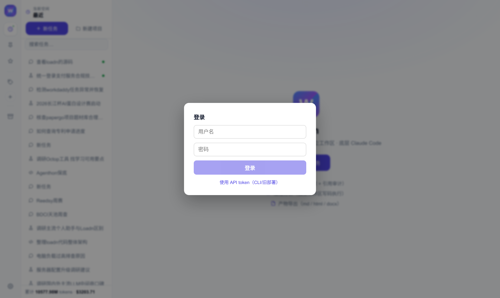
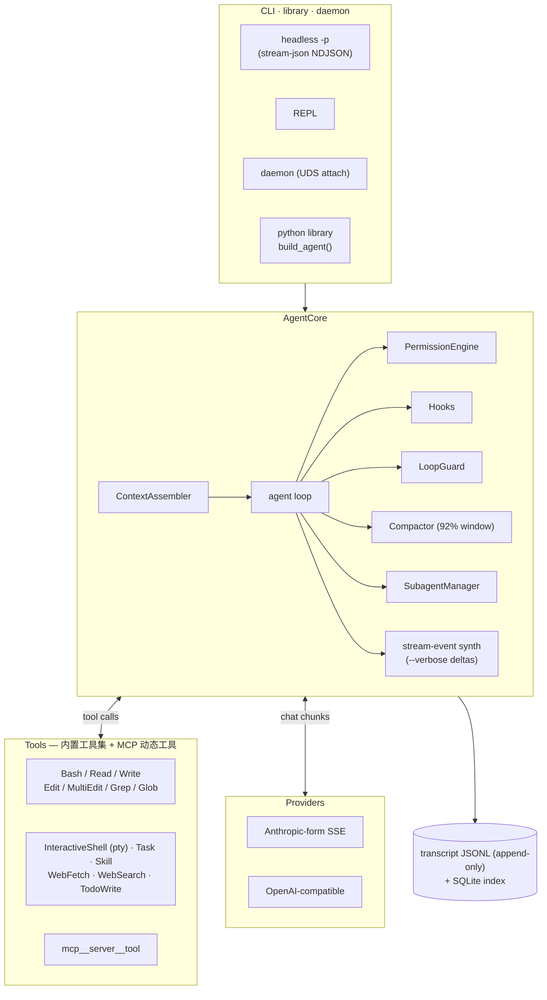
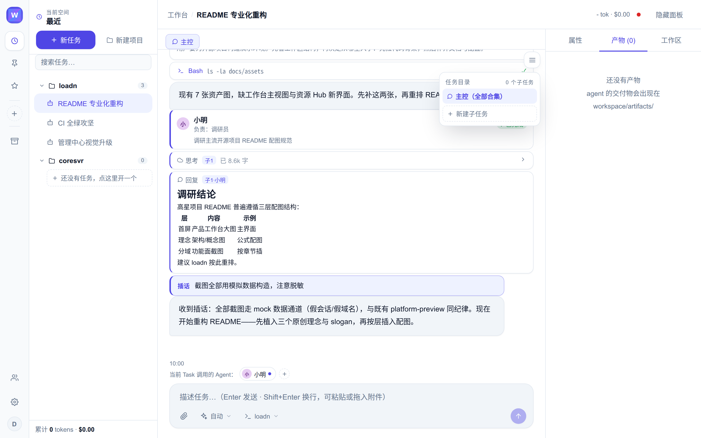
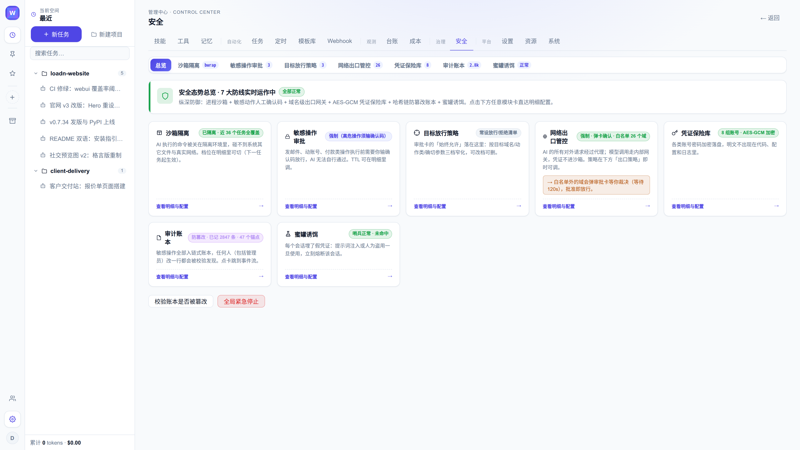
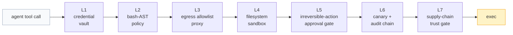

# loadn

<picture>
  <source media="(prefers-color-scheme: dark)" srcset="docs/assets/logo-dark.svg">
  
</picture>

[](https://github.com/loadn-ai/loadn/actions/workflows/ci.yml)
[](https://github.com/loadn-ai/loadn/releases)
[](LICENSE)
[](pyproject.toml)
[](https://github.com/astral-sh/ruff)

**[简体中文](README.zh-CN.md)** | English

> 天行健，OldMan；地势坤，LoadN。

> **命名。** loadn（读 *load-n*）是 loadn-ai 平台的引擎包。产品形态：
> `loadn` 引擎 / `loadn-web` 平台 / `loadn desktop` 桌面版。

## 项目简介

loadn 是一个纯 Python 实现的自包含 coding-agent 引擎，并已成长为可自
托管的 agent 平台。一次 `pip install`，配合任选的 Anthropic 形态或
OpenAI 兼容端点，即可获得一个无头 agent：内置工具、MCP 支持、子代理、
会话持久化与上下文压缩齐备。CLI 原生使用 Claude Code 的
`stream-json` 方言，为 Claude CLI 构建的 harness 可以将 loadn 作为
可替换的子进程引擎直接驱动。

同一仓库还承载引擎之外的平台部分：`loadn-web`，一个多会话 Web 应用，
提供数字员工组织架构、资源 Hub、七层执行安全栈、调度、成本核算与防
篡改审计账本。

**状态。** v0.7.x（beta），持续维护中。CLI argv 契约、`stream-json`
方言与配置键遵循语义化版本；破坏性变更随每次 minor 发布在
[CHANGELOG.md](CHANGELOG.md) 中预告。

### 仓库布局

| 路径 | 内容 | 启动方式 |
|---|---|---|
| `loadn/` | agent 引擎（本文档的主体） | `pip install loadn` |
| `loadn_webui/` | Web 平台：会话 / 组织架构 / 资源 Hub / 安全 / 调度 / 成本核算 | `pip install -e ".[webui]"` → `loadn-web init` → `loadn-web serve` |
| `desktop/` | 桌面发行版：Tauri 壳 + Debian rootfs，整个执行域运行在 macOS / Windows 内的 Linux 虚拟机中 | `desktop/image/` 构建流水线 |
| `ui/` | 管理中心 React 前端（安全 / 资源 / 组织面板） | `cd ui && npm run build` |



### 架构



## 功能特性

### Agent 运行时

- 带权限引擎、hooks 与两级 loop-guard 的 agent 循环；loop-guard 对
  重复的相同工具调用先软提醒、后硬打断。
- 92% 窗口的上下文压缩，且保持工具调用配对完整；流中断与可重试的
  供应商错误在循环内重试，一个 turn 不会以虚假成功收场。
- 会话持久化：append-only JSONL transcript 加 SQLite 索引；重放从
  最近一次压缩点续起。
- `loadn daemon` 使 AgentCore 跨断连存活（UDS attach），缓存温度与
  上下文在 UI 重连后保留。
- 长时任务：前台命令超过 60 秒自动纳入后台任务表（agent 继续工作，
  稍后读取日志）；交互式程序（REPL、安装向导）使用 pty 支撑的
  `InteractiveShell` 工具，一次调用即可脚本化多轮 send/expect 交换。

### 工具与扩展性

- 内置工具集：文件编辑（Read / Write / Edit / MultiEdit）、搜索
  （Grep / Glob）、shell（Bash、InteractiveShell）、委派（Task）、
  按需知识（Skill）、网络（WebFetch / WebSearch）与任务跟踪
  （TodoWrite）。
- MCP server 在 `.mcp.json` 中声明（stdio 与 streamable HTTP，支持
  OAuth）；其工具以 `mcp__<server>__<tool>` 形式出现。
- 技能遵循 agentskills.io 的 `SKILL.md` 标准；第三方安装需通过
  供应链锁，任意技能可导出为兼容 zip。
- 自定义子代理以 markdown 文件定义（`name/description/tools/model`
  frontmatter），经 `Task(subagent_type=...)` 使用。

### 供应商无关的模型层

任意 Anthropic 形态 SSE 端点（Z.AI GLM、Anthropic 本尊）与任意
OpenAI 兼容端点（DeepSeek、vLLM、LiteLLM 等）均可接入。
思考/推理内容与工具调用语法在单一适配层内完成翻译。

### Claude Code `stream-json` 兼容

- argv 契约与事件流刻意与 Claude Code 无头模式同构（
  `-p --verbose --output-format stream-json`、prompt 即 `argv[-1]`、
  `--session-id` / `--resume`、`system/assistant/user/result` 事件）。
- 最终 `result` 事件携带 snake_case `usage` 与 camelCase 按模型
  `modelUsage`，可直接供成本看板使用。
- 长工具运行期间 CLI 每 30 秒发送一行 `system/heartbeat`，父进程的
  卡死检测不会误杀健康任务。
- 活会话锁复现监管器依赖的 `Session ID already in use` 报错
  （stderr，exit 1）。

### 上下文工程

系统提示由 CLAUDE.md / AGENTS.md 祖先链（git 根界内、近者后置、支持
`@import`）、技能索引、边界驱动后台抽取的长期记忆与 repo 地图装配而
成——镜像 Claude Code 的分层记忆。

### 成本纪律

三个 prompt-cache 断点（工具尾 / 系统 / 末条消息），辅助调用走无缓存
通道；先剪枝再摘要的交接式压缩器（带文件账本与 UPDATE 模式）；磨洋工
拦截门（口头交付拦截 + 产物存在性检查）；末次调用记账；上下文溢出经
强制压缩自救。

### 平台（`loadn-web`）



- 多会话工作台：实时 agent 过程（思考卡、工具卡、子代理派发、插话）
  与排队消息；重载回放与实时流逐字节一致。
- 数字员工：部门树与具名员工，每位员工即一个 agent 定义（人设、技能、
  职责），热注入子代理注册表。派发按名点名——
  `Task(subagent_type="xiaoming")` 将工作连同该员工的人设与技能集路由；
  临时工池吸纳突发工作。
- 技能库：本地与市场技能，带来源徽章与生命周期状态；建议闭环将你的
  纠正转为可评审的持久技能。
- 资源 Hub：每个资源是一份 `Resource.md`，结构化表单与 markdown 源码
  双向编辑；凭证从加密凭证库按引用绑定，以 `LOADN_SVC_*` 变量注入任务
  环境，并预览 agent 将看到的确切内容。
- 调度、成本核算，以及带每日外置锚点的哈希链审计账本。

截图：组织架构页（`docs/assets/org-page.png`）、技能库
（`docs/assets/skills-page.png`）、资源 Hub
（`docs/assets/resource-hub.png`）、带注入预览的资源抽屉
（`docs/assets/resource-drawer.png`）。

### 执行安全

安全被视为四项相乘：沙箱、控制点、凭证库、审计。执行路径上没有任何
LLM；每一层都是确定性的、fail-closed。





| 层 | 公式项 | 机制 | 源码 |
|---|---|---|---|
| L1 | 凭证库 | AES-GCM 加密；明文永不进入 agent 环境 | `loadn_webui/security/vault.py` |
| L2 | 控制点 | Bash AST 策略：红线 + token 覆盖规则，进程外 PreToolUse | `loadn_webui/security/policy.py` |
| L3 | 控制点 | 出网白名单代理；CONNECT 白名单、DNS-rebinding 与私网拒绝 | `loadn_webui/security/egress_proxy.py` |
| L4 | 沙箱 | bwrap 同路径挂载；网络命名空间内代理 socket 为唯一出口 | `loadn_webui/security/sandbox.py` |
| L5 | 控制点 | 不可逆动作审批门：一次性确认码绑定参数哈希 | `loadn_webui/security/approve.py` |
| L6 | 审计 | 蜜罐绊线 + 哈希链账本，每日外置锚点 | `loadn_webui/security/canary.py` · `audit.py` |
| L7 | 控制点 | 供应链信任门：技能 sha256 锁 + 八类静态扫描 | `loadn_webui/security/skill_scan.py` |

### 质量

- 1600+ 测试，零 API 调用（fake 供应商驱动），83% 行覆盖率。
- 变异测试：向 47 个核心文件注入 4055 个缺陷，击杀率 78%，CI 中设
  每周变异门禁。见 [tests/TEST-PLAN.md](tests/TEST-PLAN.md) §7。

## 安装与快速开始

### 环境要求

Python 3.10 或更高。引擎运行时依赖仅 `httpx` 一个；可选附加项：

| 附加项 | 提供能力 |
|---|---|
| `ast` | 权限策略所需的 Bash AST 解析（`bashlex`） |
| `repomap` | repo 地图符号提取（tree-sitter） |
| `tui` | 全屏终端 UI（textual）；未安装时回落基础 REPL |
| `dev` | 测试与 lint 工具链（pytest、ruff、playwright） |
| `webui` | `loadn-web` 平台依赖（FastAPI、cryptography 等） |

### 安装引擎

```bash
pip install loadn
# 或从源码安装：
pip install git+https://github.com/loadn-ai/loadn
```

### 配置端点

无需配置文件即可使用；端点按以下顺序解析：

1. `$LOADN_HOME/config.json` —— 用户覆盖（`LOADN_HOME` 默认
   `~/.loadn`）
2. 环境变量：`ANTHROPIC_BASE_URL`、`ANTHROPIC_AUTH_TOKEN`、
   `LOADN_MODEL`、`LOADN_PROVIDER`（`anthropic` | `openai` | `fake`）
3. `~/.claude/settings.json` 的 `env` 块（如存在）——已在用 Claude
   CLI 走网关的安装被原样复用

首次运行且未配置端点时，CLI 进入引导向导（预设端点选单、掩码输入
API key），结果写入 `$LOADN_HOME/config.json`。测试与回放使用的
`fake` 供应商不会触发引导。

### 首次运行

```bash
# 一次性调用，人类可读输出
loadn -p --dangerously-skip-permissions "读 ./note.txt 并总结"

# 无头事件流（Claude Code stream-json 方言）
loadn -p --verbose --output-format stream-json \
  --session-id 11111111-2222-3333-4444-555555555555 "修掉失败的测试"

# 续会话 / 仅结构化结果 / 交互 REPL
loadn -p --resume 11111111-2222-3333-4444-555555555555 "继续"
loadn -p --output-format json "列出待办"
loadn                       # REPL：/help /resume /fork /compact /todos
```

### 开发环境

```bash
pip install -e ".[dev]"
pytest            # 1600+ 测试，零 API 调用
ruff check .
```

fake 供应商（`LOADN_PROVIDER=fake`）从 `$LOADN_FAKE_DIR` 回放控制
文件——与端到端 CLI 测试使用同一协议。pytest 之外，10 个 eval 场景
每夜门禁发版，`scripts/mutate.py` 度量测试是否真正杀死注入的缺陷。
新守卫逻辑与变异 TARGET_TESTS 映射的贡献规则见
[CONTRIBUTING.md](CONTRIBUTING.md)。

## 使用示例

### 事件流形状

stdout 上的 NDJSON，每行一个 JSON 对象：

```json
{"type":"system","subtype":"init","session_id":"…","model":"…","tools":[…]}
{"type":"stream_event","event":{"type":"content_block_delta","index":0,"delta":{"type":"text_delta","text":"让我 "}},"parent_tool_use_id":null}
{"type":"assistant","message":{"id":"msg_…","role":"assistant","content":[{"type":"tool_use","id":"tu_1","name":"Bash","input":{"command":"ls"}}]}}
{"type":"user","message":{"role":"user","content":[{"type":"tool_result","tool_use_id":"tu_1","content":"…","is_error":false}]}}
{"type":"result","subtype":"success","usage":{"input_tokens":…,"output_tokens":…,"cache_read_input_tokens":…,"cache_creation_input_tokens":…},"modelUsage":{…},"num_turns":2,"duration_ms":…}
```

`stream_event` 行（Anthropic SSE 形态 delta，仅 `--verbose` 下输出）
是尽力而为的直播传输；装配后的 `assistant` 事件永远是事实来源。
退出码：`0` 成功，`1` 任意 `error_*` 结局。

### 作为 Python 库使用

```python
import asyncio
from pathlib import Path
from loadn.core.build import build_agent

async def main():
    bundle = await build_agent(Path.cwd())          # 供应商/工具/会话已接线
    summary = await bundle.core.run_turn("找出 TODO 并写进 notes/")
    print(summary.text, summary.usage, summary.model_usage)

asyncio.run(main())
```

`AgentCore` 亦可分件构造（自定义工具注册表、权限模式、hooks、关闭
压缩器等）——见 `loadn/core/build.py`。

### 嵌入既有 harness

CLI 镜像 Claude Code 的无头契约，任何 spawn
`claude -p --output-format stream-json` 的监管器都可以改为 spawn
`loadn`：

- 新会话：`--session-id <uuid>`；续接：`--resume <uuid>`；`--fork`
  将续接的会话复制到新 id
- 活会话的并发复用被拒绝，报错措辞相同（`Session ID already in
  use`，stderr，exit 1）
- 记账：最终 `result` 事件携带 `usage` 与按模型 `modelUsage`，供
  成本看板直取
- 每会话 transcript 位于 `$LOADN_HOME/sessions/<sid>/`
  （append-only JSONL；重放从最近压缩点续起）
- 长驻托管：`loadn daemon` 使 AgentCore 跨断连存活（UDS attach）

### 部署平台

```bash
pip install -e ".[webui]"
loadn-web init --model <model> --base-url <url> --api-key <key>
loadn-web serve          # loadn-web doctor 执行自检
```

管理中心（安全 / 资源 / 组织面板）为 `ui/` 下的 React 前端。桌面
发行版由 `desktop/image/` 流水线构建。

## 配置说明

| 事项 | 位置 |
|---|---|
| 引擎阈值、预算与上限 | `loadn/constants.py` |
| 权限规则 | 项目内 `.loadn/settings.json`（deny/allow、`Bash:git push*` 模式；兼容旧路径 `.agent/`）；模式：`default` / `acceptEdits` / `plan` / `bypassPermissions` |
| Hooks（Pre/PostToolUse、Stop、Session*） | `.loadn/settings.json` 的 `hooks` 键——外部命令、stdin JSON、退出码 2 阻断 |
| MCP server | 项目内 `.mcp.json`（stdio 与 streamable HTTP，支持 OAuth） |
| 技能 | `.agents/skills/`（agentskills.io 标准，最高优先）/ `.claude/skills/` / `.loadn/skills/` / `$LOADN_HOME/skills`——进系统提示索引，正文经 `Skill` 工具按需加载 |
| 自定义子代理 | `.claude/agents/*.md` / `$LOADN_HOME/agents`——frontmatter `name/description/tools/model`；平台员工热注入于此 |
| 宪法链 | git 根到 cwd 的 CLAUDE.md / AGENTS.md，近者后置；`@./file.md` 行内导入；用户级 `$LOADN_HOME/AGENT.md` 叠加 |
| 平台配置（50+ 键） | 数据根的 `config.yaml`，由 `loadn-web init` 生成（模板：`config.yaml.example`）；全部键见 [docs/CONFIG.md](docs/CONFIG.md) |
| 思考预算 | `LOADN_THINKING_BUDGET` 环境变量或 `extra.thinking_budget`（Anthropic 形态 `thinking.budget_tokens`；默认关闭） |
| 提示缓存 | 默认开启（三个断点）；`extra.disable_prompt_cache` 关闭 |

## 文档链接

| 文档 | 内容 |
|---|---|
| [docs/ARCHITECTURE.md](docs/ARCHITECTURE.md) | 平面划分、数据布局、测试体系 |
| [docs/CONFIG.md](docs/CONFIG.md) | 全部配置键 |
| [docs/EXTENDING.md](docs/EXTENDING.md) | 定制缝：引擎、供应商、技能、MCP、hooks |
| [docs/PROTOCOL.md](docs/PROTOCOL.md) | 引擎事件方言契约 |
| [docs/RELEASE.md](docs/RELEASE.md) | 部署、升级、回滚 |
| [docs/ATTACK_SURFACE.md](docs/ATTACK_SURFACE.md) | 攻击面与 AI-BOM |
| [docs/compat.md](docs/compat.md) | 兼容性说明 |
| [docs/adr/](docs/adr/) | 架构决策记录 |
| [CHANGELOG.md](CHANGELOG.md) | 发布历史 |
| [ROADMAP.md](ROADMAP.md) | 路线图与待办里程碑 |
| [CONTRIBUTING.md](CONTRIBUTING.md) | 目录布局、单文件加工具/供应商的路径、断言强度规则 |
| [SECURITY.md](SECURITY.md) | 安全策略 |
| [CODE_OF_CONDUCT.md](CODE_OF_CONDUCT.md) | 行为准则 |
| [tests/TEST-PLAN.md](tests/TEST-PLAN.md) | 测试计划，含变异测试方法论 |
| [CITATION.cff](CITATION.cff) | 引用元数据 |

## 常见问题

**支持哪些模型与供应商？**
模型层与供应商无关：任意 Anthropic 形态 SSE 端点（如 Z.AI GLM、
Anthropic）与任意 OpenAI 兼容端点（DeepSeek、vLLM、LiteLLM 等）。
用 `LOADN_PROVIDER` 选择，`ANTHROPIC_BASE_URL` 指向网关。

**首次使用前必须写配置吗？**
不必。端点解析顺序见「安装与快速开始」；未配置端点的首次运行会进入
交互式引导向导并写入 `$LOADN_HOME/config.json`。`fake` 供应商不会
触发引导。

**会话存储在哪里？**
`$LOADN_HOME/sessions/<session-id>/`（默认 `~/.loadn`）：append-only
JSONL transcript 加 SQLite 索引。重放从最近一次压缩点续起。

**loadn 能在既有监管器中替代 `claude -p` 吗？**
可以。argv 契约与事件流刻意同构，且活会话锁复现监管器依赖的
`Session ID already in use` 报错（stderr，exit 1）。

**CI 中如何关闭权限确认？**
使用 `--dangerously-skip-permissions`（别名 `--yolo`）或
`--permission-mode bypassPermissions`。交互使用时建议在
`.loadn/settings.json` 中配置收窄的 deny/allow 规则。

**退出码含义？**
`0` 成功；`1` 任意 `error_*` 结局。

**测试会调用付费 API 吗？**
不会。1600+ 测试全部运行在 fake 供应商上，零 API 调用。

**引擎、平台与桌面版是什么关系？**
一个 monorepo，三种产品形态：`loadn` 引擎、`loadn-web` 平台（CLI
入口 `loadn-web`；`wd` 为废弃别名）、以及由 `desktop/` 构建的桌面
发行版。

**如何新增工具、供应商或技能？**
见 [docs/EXTENDING.md](docs/EXTENDING.md) 与
[CONTRIBUTING.md](CONTRIBUTING.md)；多数扩展只需一个文件。

**有桌面应用吗？**
有。`desktop/` 为 Tauri 发行版（执行域运行在 macOS / Windows 内的
Linux 虚拟机中）；真机验证正在进行。

## 许可证

Apache-2.0——见 [LICENSE](LICENSE)。
