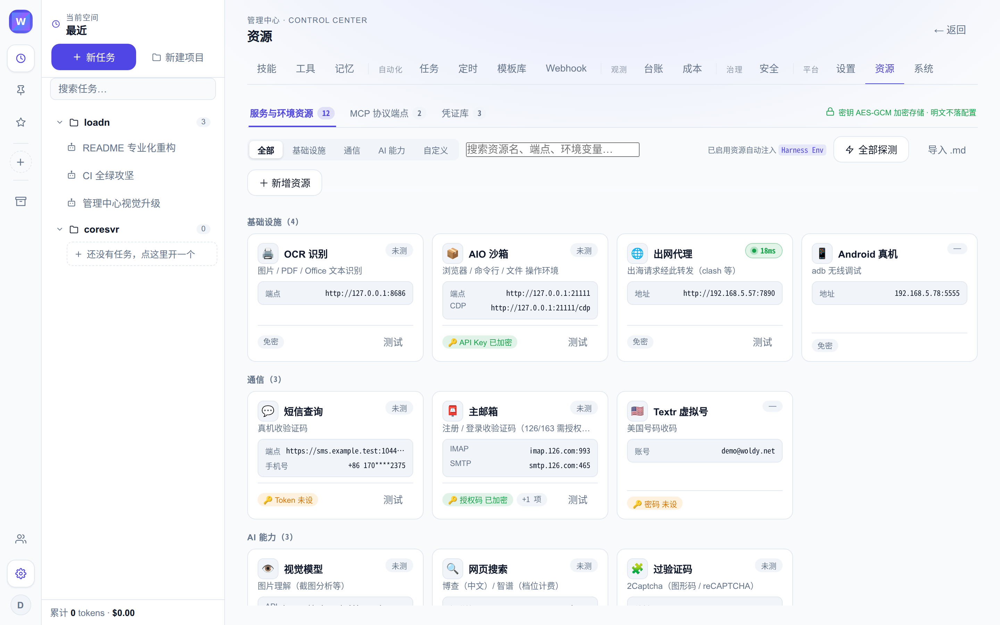
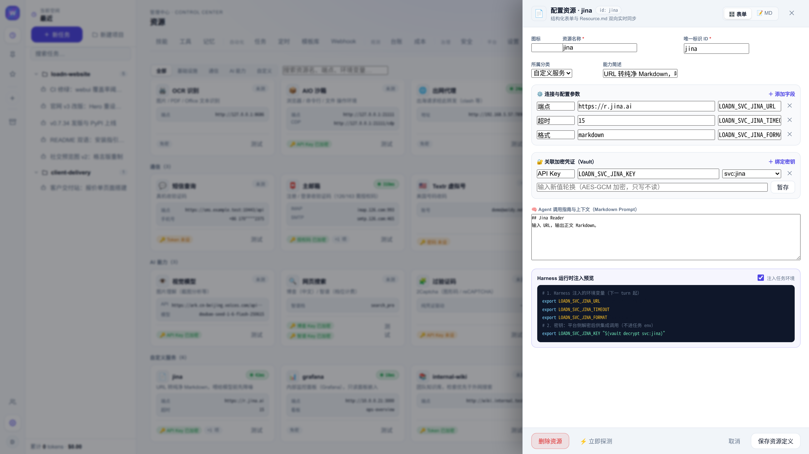
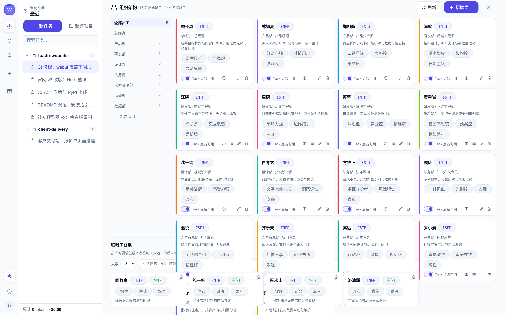
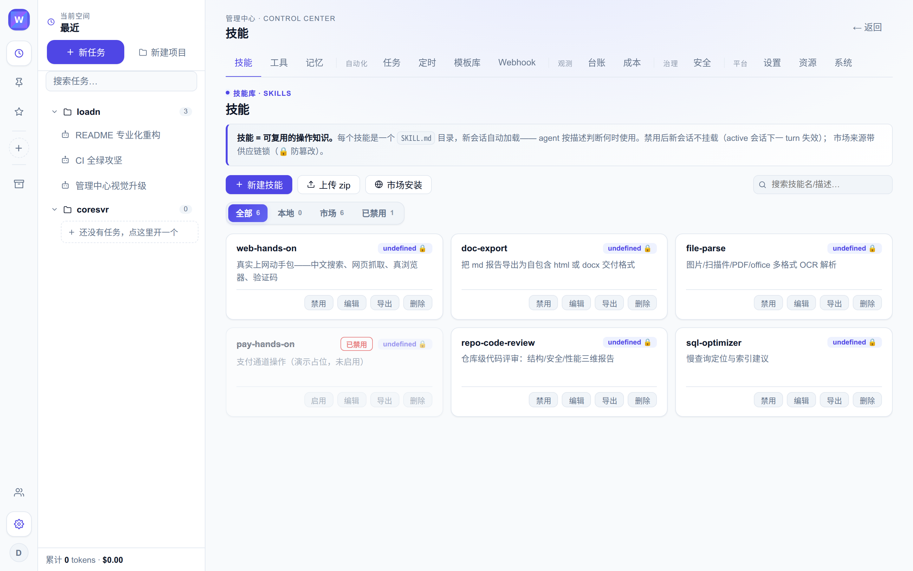
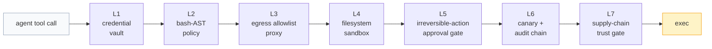

# loadn（老登，读 **load-n**）

<picture>
  <source media="(prefers-color-scheme: dark)" srcset="docs/assets/logo-dark.svg">
  
</picture>

[](https://github.com/loadn-ai/loadn/actions/workflows/ci.yml)
[](https://github.com/loadn-ai/loadn/releases)
[](LICENSE)
[](pyproject.toml)
[](https://github.com/astral-sh/ruff)

简体中文 | **[English](README.md)**

> ### 天行健，oldman，地势坤，loadn。
>
> loadn 读 load-n，谐音「老登」，即 oldman。名字取自《周易》乾坤二卦：
> 乾曰「天行健，君子以自强不息」——是为 oldman，老而弥坚；坤曰
> 「地势坤，君子以厚德载物」——是为 loadN，load N，载物无算。一名
> 两卦，一动一静：引擎当锐意进取，平台当承载万物。
>
> 只是年纪过大，已经算不上君子了——所以，叫老登。

**纯 Python 自包含的 coding-agent 引擎，长成可自托管的 agent 平台。**
一次 `pip install`，任选 Anthropic 形态或 OpenAI 兼容端点，即得一个无头
agent：工具、MCP、子代理、会话持久化、上下文压缩齐备——说 Claude Code
的 `stream-json` 方言，既有 harness 可把它当可替换的子进程引擎直接驱动。
引擎之外是多层会话 Web 平台：数字员工组织架构、资源 Hub、七层执行安全
栈、调度、成本核算与防篡改审计账本。

> **状态：** `v0.7.x`（beta）持续演进中。CLI argv 契约、`stream-json`
> 方言与配置键遵循 SemVer；破坏性变更随每次 minor bump 在
> [CHANGELOG.md](CHANGELOG.md) 预告。
>
> 命名：loadn 是 loadn-ai 平台的引擎包（org: **loadn-ai**）。「老登」既是
> 名字的谐音出处，也是平台吉祥物（昵称老 bike）。产品形态：loadn
> webui / loadn desktop。

## 工作台

会话、agent 过程直播（思考卡 / 工具卡 / 子代理派发 / 插话）、排队消息、
产物清单——一屏尽览：


截图中可见的平台特性：由 `TodoWrite`/`TaskCreate` 事件同步的**任务清单**、
**可折叠思考卡**（按代理归属、子代理思考带实时累计字数）、任务委派给具名
数字员工时的**派发卡**、**插话卡**（运行中插话，下一轮 LLM 调用前注入）、
带 GFM 表格的 markdown 回复。**重载回放与实时流逐字节同构**——同组件、
同顺序、内容零丢失。

---

## 三大原创理念

平台是三个原创理念的部署形态。每个公式给出名词项；每张截图都是公式
在运行中的样子。

### 理念一 · Agent = Model + Harness + Resource

Agent 不等于模型。模型是租来的；**Harness** 是包裹它的工程纪律（循环
控制、权限引擎、上下文压缩、子代理管理、事件方言）；**Resource** 是
这个世界真正允许 agent 使用的东西——端点、凭证、传感器、出网通道、
无头浏览器。loadn 把每一项都做成显式且可替换的：模型层与供应商无关
（任选 Anthropic 形态或 OpenAI 兼容端点），harness 就是你正在读的这个
引擎，资源则是一等公民，在**资源 Hub** 中统一管理：



每个资源以 `Resource.md` 定义（结构化表单 ↔ markdown 源码双向实时同步），
凭证从加密凭证库按引用绑定，并以 `LOADN_SVC_*` 环境变量注入任务环境——
注入预览精确展示 agent 将看到的一切：



### 理念二 · Digital Employee = Agent + Skills + Memory

平台运行的是一个**组织**，而非单个 agent。部门树与具名员工在组织架构页
定义（每位员工即一个 agent 定义：MBTI 人设、技能、职责——热注入子代理
注册表）；**技能**是 agentskills.io 标准的 `SKILL.md` 包，可随时间教学
积累（技能建议闭环把你的纠正转成可评审的持久技能）；**记忆**按用户 /
项目 / 工作区三级分区，支持快照与回滚：





派发按名点名：`Task(subagent_type="小明")` 把工作连同人设与技能集路由给
员工小明；结果、思考与文件以归属标记回流。突发工作可从临时工池招募——
编制弹性伸缩，组织始终可读。

### 理念三 · Security = Sandbox + Control Points + Vault + Audit

安全不是勾选项，是**四项相乘**。**沙箱**圈住可逆工作（bwrap 挂载 +
netns，出网只走白名单代理）；**控制点**守住不可逆动作（bash-AST 策略、
出网三态策略、参数哈希绑定一次性确认码的审批门）；**凭证库**让每份凭证
AES-GCM 加密、明文永不进入 agent 环境；**审计**账本把每次裁决哈希链式
串联、每日外置锚点。执行路径上没有任何 LLM——每一层都是确定性、
fail-closed：




| # | 公式项 | 机制 | 源码 |
|---|---|---|---|
| L1 | Vault（凭证库） | AES-GCM；明文永不进入 agent 环境 | `loadn_webui/security/vault.py` |
| L2 | Control point | bash-AST 策略：L0 红线+token 覆盖规则，进程外 PreToolUse | `loadn_webui/security/policy.py` |
| L3 | Control point | 出网白名单代理；CONNECT 白名单、DNS-rebinding 与私网拒绝 | `loadn_webui/security/egress_proxy.py` |
| L4 | Sandbox（沙箱） | bwrap 同路径挂载；netns 内代理 socket 为唯一出口 | `loadn_webui/security/sandbox.py` |
| L5 | Control point | 不可逆动作审批门：一次性确认码绑定参数哈希 | `loadn_webui/security/approve.py` |
| L6 | Audit（审计） | 蜜罐绊线+哈希链账本，每日外置锚点 | `loadn_webui/security/canary.py` · `audit.py` |
| L7 | Control point | 供应链信任门：技能 sha256 锁+八类静态扫描 | `loadn_webui/security/skill_scan.py` |

---

## 架构


## Monorepo：引擎 + 平台

本仓库不止是引擎——一个可完整自托管的**多会话 agent 平台**：

| 组件 | 是什么 | 启动 |
|---|---|---|
| `loadn/` | 引擎（本 README 主体） | `pip install loadn` |
| `loadn_webui/` | Web 平台：会话 / 组织架构 / 资源 Hub / 安全 / 调度 / 成本，含上述七层执行安全栈 | `pip install -e ".[webui]"` → `loadn-web init` → `loadn-web serve` |
| `desktop/` | 桌面形态（Tauri 壳+Debian rootfs：整个执行域跑在 mac/win 内的 Linux VM 里） | `desktop/image/` 构建流水线 |
| `ui/` | React 前端（管理中心：安全 / 资源 / 组织面板） | `cd ui && npm run build` |


文档索引：[ARCHITECTURE](docs/ARCHITECTURE.md)（平面 / 数据布局 /
测试体系）· [CONFIG](docs/CONFIG.md)（每个配置键）·
[EXTENDING](docs/EXTENDING.md)（定制缝：引擎 / 供应商 / 技能 / MCP /
hooks）· [PROTOCOL](docs/PROTOCOL.md)（引擎方言契约）·
[RELEASE](docs/RELEASE.md)（部署 / 升级 / 回滚）·
[ATTACK_SURFACE](docs/ATTACK_SURFACE.md)（攻击面+AI-BOM）。

## 为什么再造一个 agent 引擎

- **可嵌入、可魔改。** 类型化 Python 3.10+，运行时依赖只有 `httpx`。
  核心循环（`AgentCore.run_turn`）首先是库；CLI 只是它外面的一层薄壳。
- **原生说 `stream-json`。** CLI 的 argv 契约与事件流刻意与 Claude Code
  无头模式同构（`-p --verbose --output-format stream-json`、prompt 即
  `argv[-1]`、`--session-id`/`--resume`、带 `usage`+按模型 `modelUsage`
  的 `system/assistant/user/result` 事件，`--verbose` 下另有逐 delta 的
  `stream_event` 行供打字机渲染）。为 Claude CLI 造的 harness 可以直接
  改 spawn loadn——监管、记账、UI 全部继续工作。
- **供应商无关。** Anthropic 形态网关（Z.AI GLM、Anthropic 本尊）与任意
  OpenAI 兼容端点（DeepSeek、vLLM、LiteLLM……）皆可，思考/推理与工具
  调用翻译收在一个适配层。
- **纪律内建。** 输出截断预算、写前读守卫、打断重复同调的两级 loop-guard
  （软提醒→硬打断）、子进程双信号卡死检测、保工具调用配对的压缩。流中断
  与可重试供应商错误在循环内重试——一个 turn 永不带着假成功收场。超长
  prompt（E2BIG）透明回落 stdin 注入。
- **默认省钱。** 三个 prompt-cache 断点（工具尾/系统/末条消息）+辅助调用
  无缓存道；先剪枝再摘要的交接式压缩器（带文件账本与 UPDATE 模式）；
  磨洋工拦截门（口头交付拦截+产物存在性检查）；末次调用记账；上下文
  溢出自救（强制压缩）。
- **不会死等 shell。** 前台命令超 60s 自动收养进后台任务表（agent 继续
  干活、稍后 `tail` 日志）；交互程序（REPL/终端游戏/安装向导）走 pty 支撑
  的 `InteractiveShell` 工具，一次调用脚本化多轮 send/expect。
- **上下文工程。** 系统提示由 CLAUDE.md / AGENTS.md 祖先链（git 根界内、
  近者后置、支持 `@import`）+技能索引+边界驱动后台抽取的长期记忆+repo
  地图装配——镜像 Claude Code 的分层记忆。
- **变异测试。** 1600+ 测试（零 token、fake 供应商驱动）83% 行覆盖——
  覆盖率之外，自研变异测试器已向 47 个核心文件注入 **4055 个缺陷、击杀率
  78%**，证明断言真的能抓住回归而不是只执行代码路径。见
  [tests/TEST-PLAN.md](tests/TEST-PLAN.md) §7。

## 安装

```bash
pip install loadn          # 或：pip install git+https://github.com/loadn-ai/loadn
```

零配置即可用——端点解析顺序：

1. `$LOADN_HOME/config.json`（你的覆盖）
2. 环境变量：`ANTHROPIC_BASE_URL` / `ANTHROPIC_AUTH_TOKEN` / `LOADN_MODEL`
   / `LOADN_PROVIDER`（`anthropic` | `openai` | `fake`）
3. `~/.claude/settings.json` 的 env 块（已在用 Claude CLI 走网关的话，
   loadn 原样复用）

## 快速上手

```bash
# 一次性调用，人类可读输出
loadn -p --dangerously-skip-permissions "读 ./note.txt 并总结"

# 无头事件流（Claude Code stream-json 方言）
loadn -p --verbose --output-format stream-json \
  --session-id 11111111-2222-3333-4444-555555555555 "修掉失败的测试"

# 续会话 / 仅结构化结果 / 交互 REPL
loadn -p --resume 11111111-2222-3333-4444-555555555555 "继续"
loadn -p --output-format json "列出待办"
loadn                       # REPL：/help /resume /fork /compact /todos
```

事件流形状（stdout NDJSON，每行一个 JSON 对象）：

```json
{"type":"system","subtype":"init","session_id":"…","model":"…","tools":[…]}
{"type":"stream_event","event":{"type":"content_block_delta","index":0,"delta":{"type":"text_delta","text":"让我 "}},"parent_tool_use_id":null}
{"type":"assistant","message":{"id":"msg_…","role":"assistant","content":[{"type":"tool_use","id":"tu_1","name":"Bash","input":{"command":"ls"}}]}}
{"type":"user","message":{"role":"user","content":[{"type":"tool_result","tool_use_id":"tu_1","content":"…","is_error":false}]}}
{"type":"result","subtype":"success","usage":{"input_tokens":…,"output_tokens":…,"cache_read_input_tokens":…,"cache_creation_input_tokens":…},"modelUsage":{…},"num_turns":2,"duration_ms":…}
```

`stream_event` 行（Anthropic SSE 形态 delta，仅 `--verbose`）是尽力而为
的直播传输——装配后的 `assistant` 事件永远是真源。退出码：`0` 成功、
`1` 任意 `error_*` 结局。长工具运行期间 CLI 每 30s 发一行
`system/heartbeat`，父进程卡死检测不会误杀健康工作。

## 作为库使用

```python
import asyncio
from pathlib import Path
from loadn.core.build import build_agent

async def main():
    bundle = await build_agent(Path.cwd())          # 供应商/工具/会话已接线
    summary = await bundle.core.run_turn("找出 TODO 并写进 notes/")
    print(summary.text, summary.usage, summary.model_usage)

asyncio.run(main())
```

`AgentCore` 也可分件构造（自定义工具注册表、权限模式、hooks、关压缩器
……）——见 `loadn/core/build.py`。

## 嵌入既有 harness

CLI 镜像 Claude Code 的无头契约，任何 spawn
`claude -p --output-format stream-json` 的监管器都可以改 spawn `loadn`：

- 新会话：`--session-id <uuid>`；续接：`--resume <uuid>`
- 活会话锁拒绝并发复用，报错措辞同款（`Session ID already in use`，
  stderr，exit 1）
- 记账：最终 `result` 事件带 snake_case `usage` 与 camelCase 按模型
  `modelUsage`，供成本看板直取
- 每会话 transcript 在 `$LOADN_HOME/sessions/<sid>/`（append-only
  JSONL；重放从最近压缩点续起）
- 长驻托管：`loadn daemon` 让 AgentCore 跨断连存活（UDS attach），
  缓存温度与上下文在 UI 重连后保留

## 配置与扩展点

| 事物 | 位置 |
|---|---|
| 引擎旋钮（阈值/预算/上限） | `loadn/constants.py` |
| 权限规则 | 项目内 `.loadn/settings.json`（deny/allow、`Bash:git push*` 模式；兼容 `.agent/` 旧路径）；模式 `default/acceptEdits/plan/bypassPermissions` |
| Hooks（Pre/PostToolUse、Stop、Session*） | `.loadn/settings.json` `hooks`——外部命令、stdin JSON、exit 2 阻断 |
| MCP servers | 项目内 `.mcp.json`（stdio+streamable-HTTP 带 OAuth）；工具以 `mcp__<server>__<tool>` 出现 |
| 技能 | `.agents/skills/`（agentskills.io 标准，最高优先）/ `.claude/skills/` / `.loadn/skills/` / `$LOADN_HOME/skills` 的 SKILL.md——进系统提示索引；正文按需经 `Skill` 工具加载（第三方安装走供应链锁；任意技能可导出 agentskills.io 兼容 zip） |
| 自定义子代理 | `.claude/agents/*.md` / `$LOADN_HOME/agents`——frontmatter `name/description/tools/model`；可 `Task(subagent_type=…)` 使用；组织架构页员工热注入于此 |
| 宪法链 | git 根到 cwd 的 CLAUDE.md/AGENTS.md，近者后置；`@./file.md` 行内导入；用户级 `$LOADN_HOME/AGENT.md` 叠加 |
| 平台配置（50+ 键） | [docs/CONFIG.md](docs/CONFIG.md)——沙箱分档、出网白名单/三态策略、审批 TTL、资源桥接 |
| 思考预算 | `LOADN_THINKING_BUDGET` 环境变量或 `extra.thinking_budget`（Anthropic 形态 `thinking.budget_tokens`；默认关） |
| 提示缓存 | 默认开（3 断点）；`extra.disable_prompt_cache` 关闭 |

## 测试你的改动

```bash
pip install -e ".[dev]"
pytest            # 1600+ 测试，零 API 调用
ruff check .
```

fake 供应商（`LOADN_PROVIDER=fake`）从 `$LOADN_FAKE_DIR` 回放控制文件——
与端到端 CLI 测试同一协议。pytest 之外：10 个 eval 场景每夜门禁发版，
`scripts/mutate.py` 度量你的测试是否真的杀死注入的缺陷（贡献经验法则见
[CLAUDE.md](CLAUDE.md) §测试同步纪律：新守卫逻辑须配负路径测试；新模块
须进变异 TARGET_TESTS 映射）。

## 状态与路线图

- [x] v0.4.x——开源就绪：可移植默认值、引擎插件入口、社区文件、零 lint 债
- [x] v0.6.0——按任务隔离工作区、轮换锚点、崩溃恢复记账、供应商思考续传
- [x] v0.6.3——交互式出网控制：off/warn/enforce+请求审批卡、会话级覆盖、
      按会话归因
- [x] v0.6.5——安全机制全部显式可配；宿主资源桥接
- [x] post-0.6.5——测试质量运动：83% 覆盖、47 文件/4055 变异体（78%
      击杀率）变异验证、CI 每周变异门禁
- [x] v0.7.x——运维硬化：回放对齐聊天（重载与实时同构）、Resource Hub
      双向 `Resource.md` 编辑、数字员工（组织/职责/临时工池）、非空闲
      升级守卫、管理中心重构（见 CHANGELOG）
- [ ] PyPI 首发版（名称已预留；tag → build → publish 全自动）
- [ ] desktop 真机验证（mac/win）
- [ ] 文档站（GitHub Pages：README/ARCHITECTURE/CONFIG/EXTENDING）
- [ ] Terminal-Bench 基线数据
- [ ] Ollama 供应商、DeepSeek 原生；TUI（textual）
- [ ] MCP server 模式（loadn 作为 MCP server 被驱动）

见 [CHANGELOG.md](CHANGELOG.md) 与 [ROADMAP.md](ROADMAP.md)。欢迎贡献——
[CONTRIBUTING.md](CONTRIBUTING.md) 讲清目录布局、一个文件加一个工具/
供应商的路径，以及断言强度规则（新守卫配负路径测试；触碰文件配变异
窄集）。

## 许可

Apache-2.0——见 [LICENSE](LICENSE)。
