# loadn

<picture>
  <source media="(prefers-color-scheme: dark)" srcset="docs/assets/logo-dark.svg">
  
</picture>

[](https://github.com/loadn-ai/loadn/actions/workflows/ci.yml)
[](https://github.com/loadn-ai/loadn/releases)
[](LICENSE)
[](pyproject.toml)
[](https://github.com/astral-sh/ruff)
[](tests/TEST-PLAN.md)

**[简体中文](README.zh-CN.md)** | English

> 天行健，OldMan；地势坤，LoadN。

> **命名。** loadn（读 *load-n*）是 loadn-ai 平台的引擎包。产品形态：
> `loadn` 引擎 / `loadn-web` 平台 / `loadn desktop` 桌面版。

**可自托管的 coding-agent 平台，引擎可对 Claude Code 无缝替换。**
`loadn` 是纯 Python 实现的 agent 引擎，CLI 原生使用 Claude Code 的
`stream-json` 方言——任何为 `claude -p` 构建的 harness 无需改动即可驱动
它；并已成长为完整平台：多会话 Web 工作台、数字员工、资源 Hub、执行前
规划审批、调度、成本核算与七层执行安全栈。一次 `pip install`，任选
Anthropic 形态或 OpenAI 兼容端点，不依赖任何外部服务。

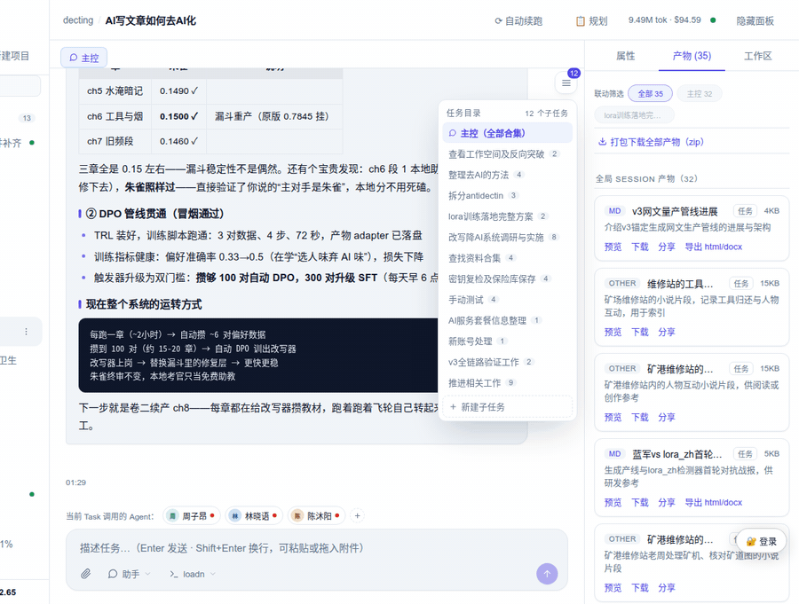

## 为什么选 loadn

| | |
|---|---|
| 🔌 **无缝替换引擎** | argv 契约与事件流和 Claude Code 无头模式同构。任何 supervisor 里把 `claude -p` 换成 `loadn -p`——会话、resume、锁、心跳、`usage`/`modelUsage` 计量全部对得上。 |
| 🏠 **自托管平台** | `loadn-web` 提供会话、项目、调度、定时唤醒、成本看板与审计——模型是你的、机器是你的、数据也是你的。 |
| 📋 **先规划后执行** | 规划模式（v0.7.74）：复杂任务先产出结构化计划卡，批准前不动任何文件；要改就直接发消息——计划 v2、v3… 循环修订。 |
| 🔐 **七层安全** | 保险库（AES-GCM）→ bash-AST 策略 → 出口白名单代理 → 文件系统沙箱 → 不可逆动作审批码 → 蜜罐+哈希链审计 → 供应链信任门。全确定性、fail-closed，执行路径上没有 LLM。 |
| 🧩 **模型层任意形态** | Anthropic 形态 SSE（GLM、Anthropic）或 OpenAI 兼容（DeepSeek、vLLM、LiteLLM…），一个适配层搞定。引擎运行时单依赖：`httpx`。 |
| 🧪 **按基础设施标准测试** | 1837 个测试、零 API 调用、≥83% 覆盖率；47 个核心文件注入 4055 个变异、78% 杀伤率，CI 周度突变门禁。 |

### 一个仓库，三种产品形态

| 路径 | 内容 | 启动方式 |
|---|---|---|
| `loadn/` | agent 引擎（本文档的主体） | `pip install loadn` |
| `loadn_webui/` | Web 平台：会话 / 组织架构 / 资源 Hub / 安全 / 调度 / 成本核算 | `pip install -e ".[webui]"` → `loadn-web init` → `loadn-web serve` |
| `desktop/` | 桌面发行版：Tauri 壳 + Debian rootfs，整个执行域运行在 macOS / Windows 内的 Linux 虚拟机中 | `desktop/image/` 构建流水线 |
| `ui/` | 管理中心 React 前端（安全 / 资源 / 组织面板） | `cd ui && npm run build` |

**状态。** v0.7.x（beta），持续维护中。CLI argv 契约、`stream-json`
方言与配置键遵循语义化版本；破坏性变更随每次 minor 发布在
[CHANGELOG.md](CHANGELOG.md) 中预告。

## 规划模式——只读规划，人来裁决

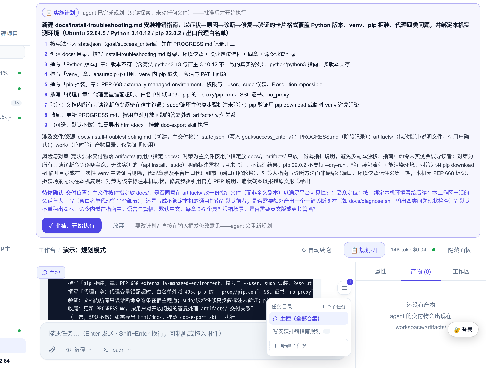

复杂或高风险的任务值得在动手前先对齐。在会话头打开 📋 **规划** 开关，
下一个任务即以*规划轮*运行：agent **只读**探索工作区（不写、不改、不删），
最终产出结构化计划卡——目标、编号步骤、涉及文件/资源、风险与对策、以及
抛回给你的待确认问题。

- **✓ 批准并开始执行** —— 计划步骤转为会话 todo 清单，随即投出执行轮
  （携带任务原文+计划全文）。todo 在场使执行轮天然不会再被拦进规划轮
  （防环）。
- **用对话修订** —— 计划卡上刻意没有「编辑」按钮：把修改意见当普通消息
  发出去，会话自动再进规划轮（计划 v2、v3…）。无头环境里 Claude Code
  plan mode 的「交互确认」在这里变成异步卡片——会话安静等你就是了。
- **放弃** —— 丢弃计划；反正什么都没动过。
- 模型未按结构输出时，回退卡展示规划原文，两个裁决选项照常可用。

## 功能巡览

| 截图 | 你看到的是 |
|---|---|
| [](docs/assets/chat-workspace.png) | **工作台** —— 实时 agent 流：思考卡、工具调用卡、子代理派发、插话便签；右面板按子任务/代理分组交付物。 |
| [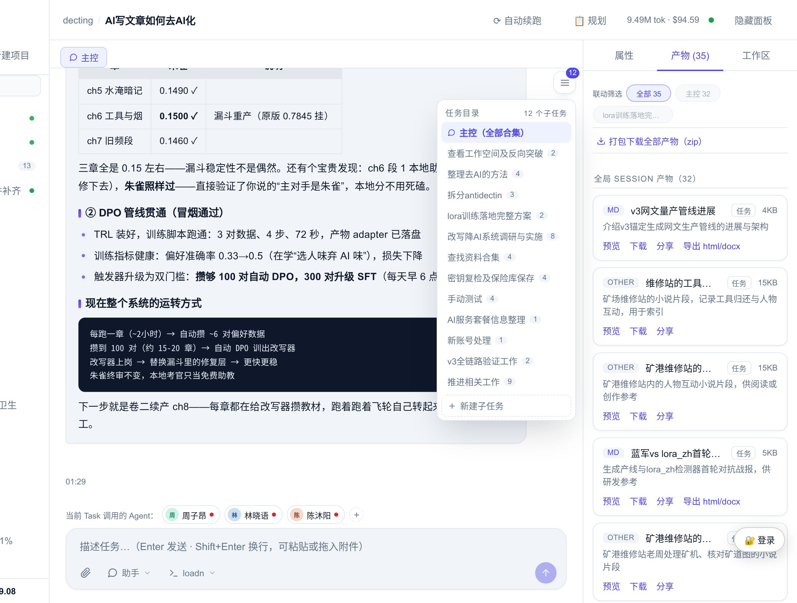](docs/assets/artifacts-panel.png) | **产物面板** —— 会话产出的每一份交付物，可预览 / 下载 / 分享 / 导出 html/docx。 |
| [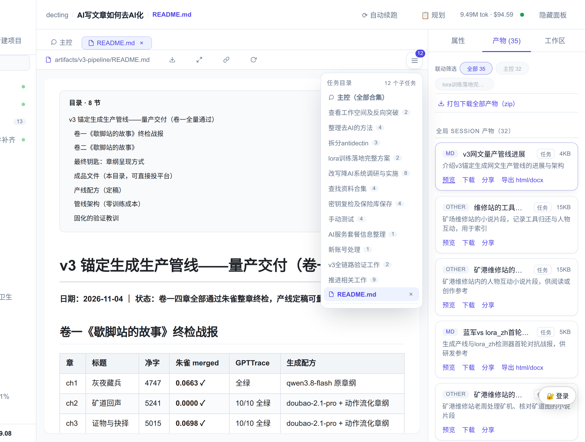](docs/assets/artifact-preview.png) | **产物就地预览** —— 不离开会话直接读交付物。 |
| [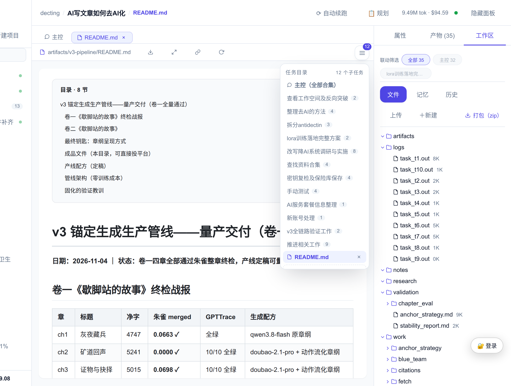](docs/assets/workspace-panel.png) | **工作区浏览器** —— 任务完整工作树，按子任务过滤，一键打包 zip。 |
| [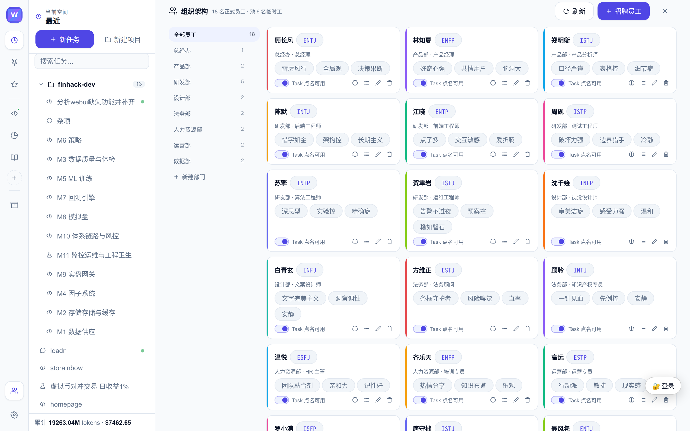](docs/assets/org-page.png) | **数字员工** —— 部门树+具名员工，每个员工是一个 agent 定义（人设/技能/职责），热注入子代理注册表；点名派发 `Task(subagent_type="xiaoming")`。 |
| [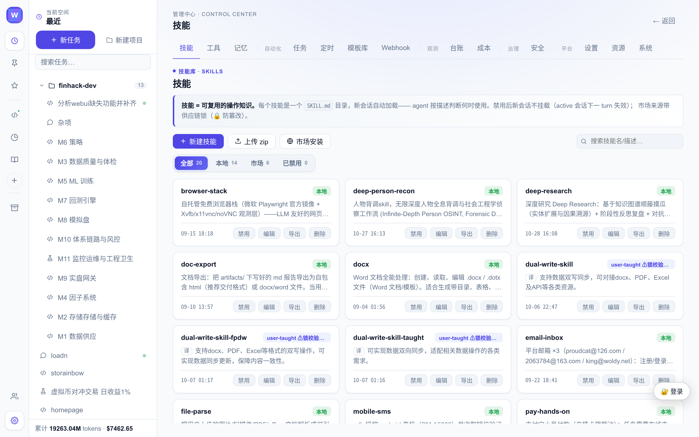](docs/assets/skills-page.png) | **技能库** —— 本地与市场技能（agentskills.io `SKILL.md`），生命周期状态；纠错建议闭环把你的修正变成可审技能。 |
| [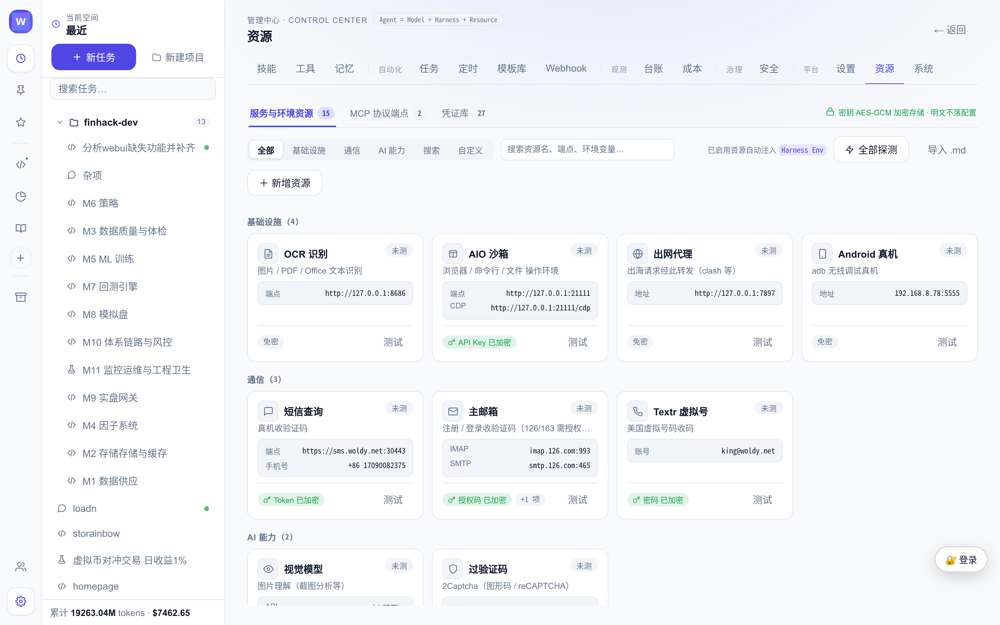](docs/assets/resource-hub.png) | **资源 Hub** —— 每个资源就是一份 `Resource.md`；凭证从加密保险库**按引用**绑定，以 `LOADN_SVC_*` 变量注入任务环境。 |
| [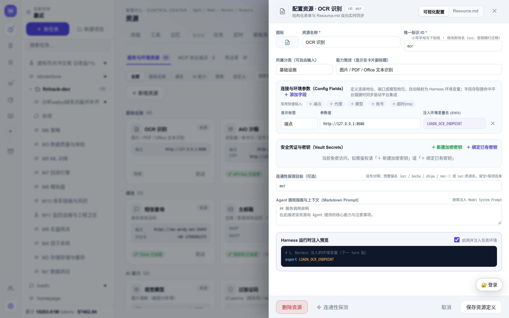](docs/assets/resource-drawer.png) | **资源抽屉** —— 结构化表单 ↔ markdown 源码双向实时同步，并预览 agent 实际将看到什么。 |
| [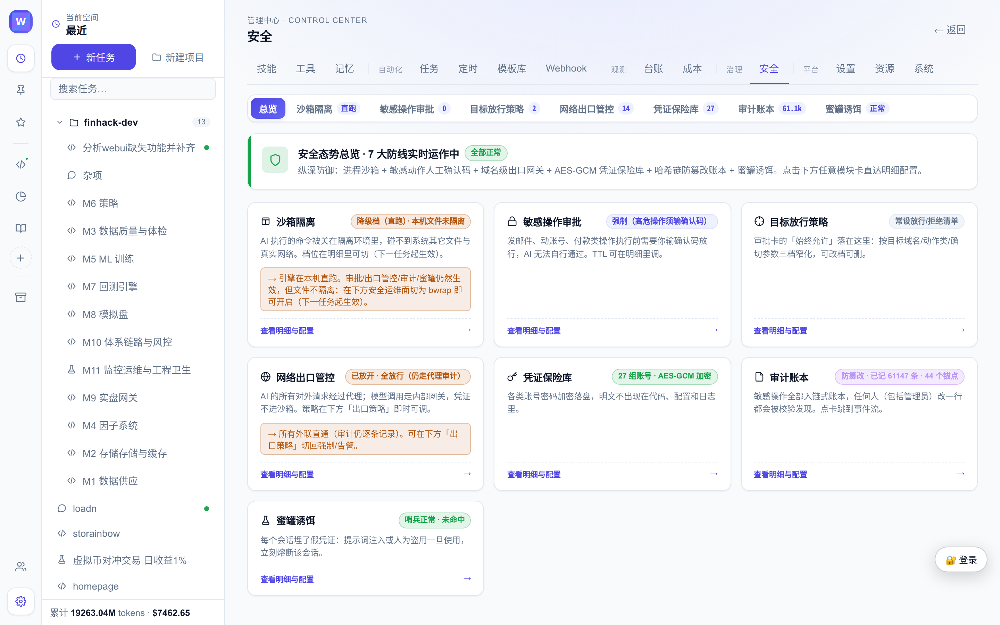](docs/assets/security-center.png) | **安全中心** —— 沙箱、审批、出口、保险库、审计、蜜罐与目标放行策略姿态一屏尽收。 |
| [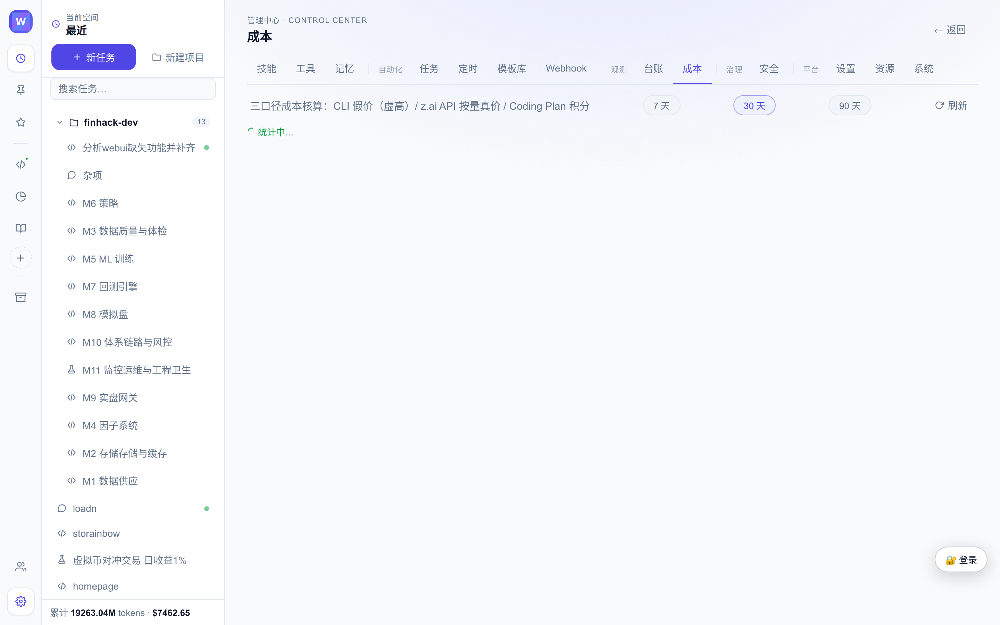](docs/assets/cost-panel.png) | **成本核算** —— 三口径成本（CLI 计价 / API 按量 / 套餐积分），7/30/90 天窗口。 |
| [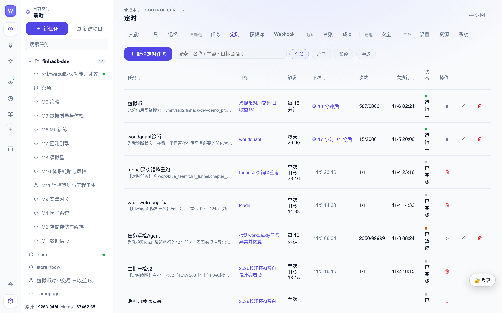](docs/assets/schedule-panel.png) | **定时调度** —— 按会话的定时唤醒与定时任务，带执行历史。 |

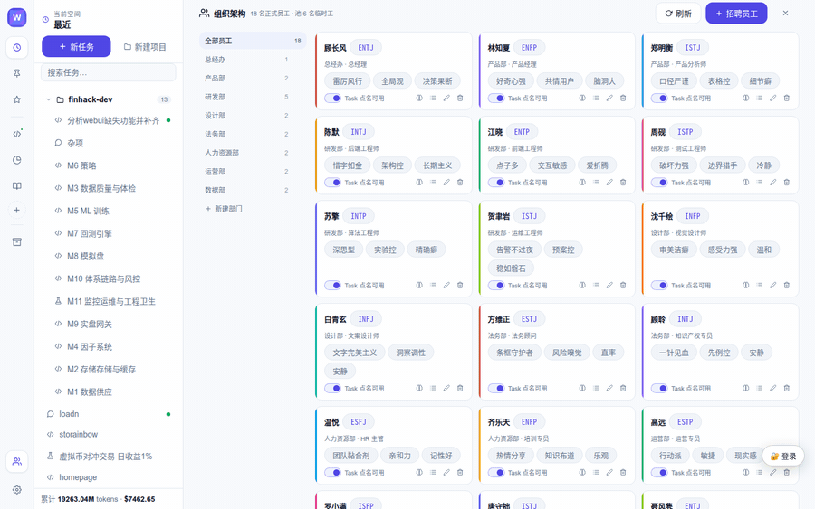

### Agent 运行时

- agent 循环带权限引擎、hooks 与两级循环守卫：重复的相同工具调用先软提醒
  再硬打断。
- 92% 窗口的上下文压缩，保留工具调用配对；流中断与可重试的 provider 错误
  在循环内重试——一个 turn 永远不会以假成功收场。
- 会话持久化：append-only JSONL 转写 + SQLite 索引；replay 从最近压缩点
  续起。重载的会话与直播流逐字节一致。
- `loadn daemon` 让 AgentCore 跨断连存活（UDS attach），缓存温度与上下文
  在 UI 重连后仍在。
- 长任务：前台命令超 60s 自动收编进后台任务表；交互式程序（REPL、安装
  向导）由 pty 支撑的 `InteractiveShell` 工具单次调用脚本化多轮
  send/expect。

### 工具与扩展

- 内置工具集：文件编辑（Read / Write / Edit / MultiEdit）、检索（Grep /
  Glob）、shell（Bash、InteractiveShell）、委派（Task）、按需知识
  （Skill）、网络（WebFetch / WebSearch）、任务跟踪（TodoWrite）。
- `.mcp.json` 声明 MCP 服务器（stdio 与带 OAuth 的 streamable HTTP）；
  其工具以 `mcp__<server>__<tool>` 形态出现。
- 技能遵循 agentskills.io `SKILL.md` 标准；第三方安装过供应链锁，任意技能
  可导出为兼容 zip。
- 自定义子代理：markdown 文件 + `name/description/tools/model`
  frontmatter，经 `Task(subagent_type=...)` 使用。

### 模型层无关供应商

任意 Anthropic 形态 SSE 端点（Z.AI GLM、Anthropic 本尊）与任意 OpenAI
兼容端点（DeepSeek、vLLM、LiteLLM 等）。思考/推理内容与工具调用语法在
单一适配层内完成翻译。

### Claude Code `stream-json` 兼容

- argv 契约与事件流刻意与 Claude Code 无头模式同构（`-p --verbose
  --output-format stream-json`、prompt 走 `argv[-1]`、`--session-id` /
  `--resume`、`system/assistant/user/result` 事件）。
- 最终 `result` 事件携带 snake_case `usage` 与 camelCase 按模型
  `modelUsage`，接成本看板即用。
- 长工具运行期间每 30s 输出一行 `system/heartbeat`，父进程的停滞检测器
  不会误杀健康工作。
- 活跃会话锁复刻 `Session ID already in use` 错误（stderr、exit 1），
  supervisor 按字面匹配即可。

### 上下文工程

系统提示由 CLAUDE.md / AGENTS.md 祖先链（git 根为界、就近在后、支持
`@import`）、技能索引、带边界驱动后台抽取的长期记忆、以及仓库地图组装而
成——对齐 Claude Code 的分层记忆。

### 成本纪律

三段提示缓存断点（工具尾 / system / 末条消息）+ 辅助调用走无缓存车道；
先修剪后摘要的 handoff 式压缩器（文件台账与 UPDATE 模式）；grind 模式
完成门（口头交付拦截+产物存在性检查）；末次调用用量核算；上下文溢出经
强制压缩自救。

### 执行安全

安全被当作四个相乘的项：沙箱、控制点、保险库、审计。执行路径上没有任何
LLM；每一层都是确定性的、fail-closed 的。

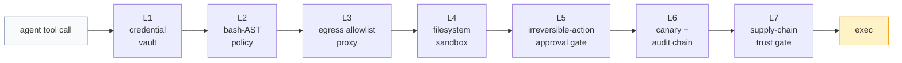

| 层 | 项 | 机制 | 源码 |
|---|---|---|---|
| L1 | 保险库 | AES-GCM 加密；明文永不进入 agent 环境 | `loadn_webui/security/vault.py` |
| L2 | 控制点 | Bash AST 策略：红线+token 覆盖规则，进程外 PreToolUse | `loadn_webui/security/policy.py` |
| L3 | 控制点 | 出口白名单代理；CONNECT 白名单、DNS-rebinding 与私网拒连 | `loadn_webui/security/egress_proxy.py` |
| L4 | 沙箱 | bwrap 同路径绑定；网络命名空间以代理 socket 为唯一出口 | `loadn_webui/security/sandbox.py` |
| L5 | 控制点 | 不可逆动作审批门：一次性审批码绑定参数哈希 | `loadn_webui/security/approve.py` |
| L6 | 审计 | 蜜罐命中+哈希链账本（每日外置锚点） | `loadn_webui/security/canary.py` · `audit.py` |
| L7 | 控制点 | 供应链信任门：技能 sha256 锁、八类静态扫描 | `loadn_webui/security/skill_scan.py` |

### 质量

- 1837 个测试、零 API 调用（fake provider 驱动）、≥83% 行覆盖率。
- 突变测试：47 个核心文件注入 4055 个变异、78% 杀伤率，CI 周度突变门禁。
  详见 [tests/TEST-PLAN.md](tests/TEST-PLAN.md) §7。

## 架构

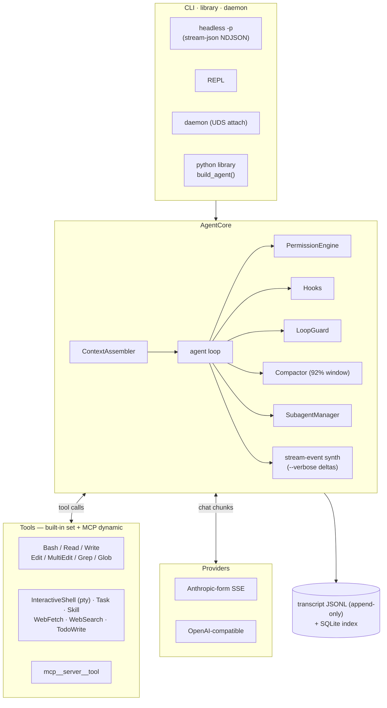

完整分层、数据布局与测试体系见 [docs/ARCHITECTURE.md](docs/ARCHITECTURE.md)。

## 快速开始

**1 · 安装**（Python ≥ 3.10；Debian 12+/Ubuntu 23.04+ 的系统 Python 请
装进 venv）：

```bash
python3 -m venv ~/.venvs/loadn
source ~/.venvs/loadn/bin/activate
pip install loadn          # 或：pip install git+https://github.com/loadn-ai/loadn
```

**2 · 配置端点** —— 无需配置文件；端点按以下顺序解析：

1. `$LOADN_HOME/config.json` —— 用户覆盖（`LOADN_HOME` 默认 `~/.loadn`）
2. 环境变量：`ANTHROPIC_BASE_URL`、`ANTHROPIC_AUTH_TOKEN`、`LOADN_MODEL`、
   `LOADN_PROVIDER`（`anthropic` | `openai` | `fake`）
3. `~/.claude/settings.json` 的 `env` 块（若存在）——已有 Claude CLI 网关
   配置原样复用

交互式终端上未配置端点的首次运行会进入引导向导（预设端点菜单、掩码输
key），写入 `$LOADN_HOME/config.json`。无头（`-p`）与非 tty stdin 永不进
向导——快速失败（exit 2）并给出提示。

**3 · 首次运行：**

```bash
# 单发，人类可读输出
loadn -p --dangerously-skip-permissions "读 ./note.txt 并总结"

# 无头事件流（Claude Code stream-json 方言）
loadn -p --verbose --output-format stream-json \
  --session-id 11111111-2222-3333-4444-555555555555 "修复失败的测试"

# 续会话 / 仅结构化结果 / 交互式 REPL
loadn -p --resume 11111111-2222-3333-4444-555555555555 "继续"
loadn -p --output-format json "列出 todos"
loadn                       # REPL：/help /resume /fork /compact /todos
```

**想要完整平台？**

```bash
pip install "loadn[webui]"
loadn-web init            # 数据根 + config.yaml 模板 + 访问 token
loadn-web serve           # http://127.0.0.1:8792 —— /docs 有交互式 API 文档
```

从源码跑完整 Web UI：`git clone
https://github.com/loadn-ai/loadn && cd loadn && pip install -e ".[webui]"`，
再 `(cd ui && npm ci && npm run build)`。

<details>
<summary><b>可选 extras</b></summary>

| Extra | 提供 |
|---|---|
| `ast` | 权限策略用的 Bash AST 解析（`bashlex`） |
| `repomap` | 仓库地图的符号提取（tree-sitter） |
| `tui` | 全屏终端 UI（textual）；不装则用基础 REPL |
| `dev` | 测试与 lint 工具链（pytest、ruff、playwright） |
| `webui` | `loadn-web` 平台依赖（FastAPI、cryptography 等） |

> TUI 注：在 Python 3.10/3.11 上验证过。Python 3.12 下伪终端环境
> （pexpect、`script(1)`、部分 CI runner）中 textual 8.x 可能不向输入框
> 投递按键事件——基础 REPL（`LOADN_NO_TUI=1`）不受影响。
</details>

## 使用示例

### 事件流形态

stdout 上的 NDJSON，每行一个 JSON 对象：

```json
{"type":"system","subtype":"init","session_id":"…","model":"…","tools":[…]}
{"type":"stream_event","event":{"type":"content_block_delta","index":0,"delta":{"type":"text_delta","text":"Let me "}},"parent_tool_use_id":null}
{"type":"assistant","message":{"id":"msg_…","role":"assistant","content":[{"type":"tool_use","id":"tu_1","name":"Bash","input":{"command":"ls"}}]}}
{"type":"user","message":{"role":"user","content":[{"type":"tool_result","tool_use_id":"tu_1","content":"…","is_error":false}]}}
{"type":"result","subtype":"success","usage":{"input_tokens":…,"output_tokens":…,"cache_read_input_tokens":…,"cache_creation_input_tokens":…},"modelUsage":{…},"num_turns":2,"duration_ms":…}
```

`stream_event` 行（Anthropic SSE 形态增量，仅 `--verbose` 时有）是直播
渲染的尽力传输；组装完成的 `assistant` 事件才是事实源。退出码：成功
`0`，任何 `error_*` 结果 `1`。

### 作为 Python 库

```python
import asyncio
from pathlib import Path
from loadn.core.build import build_agent

async def main():
    bundle = await build_agent(Path.cwd())          # provider/工具/会话已接线
    summary = await bundle.core.run_turn("找出 TODO 并写到 notes/")
    print(summary.text, summary.usage, summary.model_usage)

asyncio.run(main())
```

`AgentCore` 也可分件构造（自定义工具注册表、权限模式、hooks、关压缩器
等）——见 `loadn/core/build.py`。

### 嵌入现有 harness

任何会拉起 `claude -p --output-format stream-json` 的 supervisor 都可以
直接换成 `loadn`：

- 新会话：`--session-id <uuid>`；续跑：`--resume <uuid>`；`--fork` 把
  resume 的会话复制成新 id
- 活跃会话被并发复用时以同款措辞拒绝（`Session ID already in use`，
  stderr、exit 1）
- 计量：最终 `result` 事件携带 `usage` 与按模型 `modelUsage`，直连成本
  看板
- 每会话转写位于 `$LOADN_HOME/sessions/<sid>/`（append-only JSONL；
  replay 从最近压缩点续起）
- 长驻托管：`loadn daemon` 让 AgentCore 跨断连存活（UDS attach）

## 配置

| 项 | 位置 |
|---|---|
| 引擎阈值、预算与限制 | `loadn/constants.py` |
| 权限规则 | 项目内 `.loadn/settings.json`（deny/allow、`Bash:git push*` 模式；旧 `.agent/` 路径仍生效）；模式：`default` / `acceptEdits` / `plan` / `bypassPermissions` |
| 规划模式 | 会话级 📋 开关（默认关）——见[规划模式](#规划模式只读规划人来裁决) |
| Hooks（Pre/PostToolUse、Stop、Session*） | `.loadn/settings.json` 的 `hooks` 键——外部命令、stdin JSON、exit 2 阻断 |
| MCP 服务器 | 项目内 `.mcp.json`（stdio 与带 OAuth 的 streamable HTTP） |
| 技能 | `.agents/skills/`（agentskills.io 标准，最高优先）/ `.claude/skills/` / `.loadn/skills/` / `$LOADN_HOME/skills`——进系统提示索引，正文经 `Skill` 工具按需加载 |
| 自定义子代理 | `.claude/agents/*.md` / `$LOADN_HOME/agents`——frontmatter `name/description/tools/model`；平台员工热注入于此 |
| 宪法链 | 从 git 根到 cwd 的 CLAUDE.md / AGENTS.md，就近在后；`@./file.md` 行内导入；顶层再叠用户级 `$LOADN_HOME/AGENT.md` |
| 平台配置（50+ 键） | 数据根 `config.yaml`，`loadn-web init` 生成（模板：`config.yaml.example`）；每个键见 [docs/CONFIG.md](docs/CONFIG.md) |
| 思考预算 | `LOADN_THINKING_BUDGET` 环境变量或 `extra.thinking_budget`（Anthropic 形态 `thinking.budget_tokens`；默认关） |
| 提示缓存 | 默认开（三断点）；`extra.disable_prompt_cache` 关闭 |

## 文档

| 文档 | 内容 |
|---|---|
| [docs/ARCHITECTURE.md](docs/ARCHITECTURE.md) | 分层、数据布局、测试体系 |
| [docs/CONFIG.md](docs/CONFIG.md) | 全部配置键 |
| [docs/EXTENDING.md](docs/EXTENDING.md) | 扩展缝：引擎、provider、技能、MCP、hooks |
| [docs/PROTOCOL.md](docs/PROTOCOL.md) | 引擎事件方言契约 |
| [docs/RELEASE.md](docs/RELEASE.md) | 部署、升级、回滚 |
| [docs/ATTACK_SURFACE.md](docs/ATTACK_SURFACE.md) | 攻击面与 AI-BOM |
| [docs/compat.md](docs/compat.md) | 兼容性说明 |
| [docs/adr/](docs/adr/) | 架构决策记录 |
| [CHANGELOG.md](CHANGELOG.md) | 发布历史 |
| [ROADMAP.md](ROADMAP.md) | 路线图与待办里程碑 |
| [CONTRIBUTING.md](CONTRIBUTING.md) | 仓库布局、单文件工具/provider 配方、断言强度规则 |
| [SECURITY.md](SECURITY.md) | 安全策略 |
| [CODE_OF_CONDUCT.md](CODE_OF_CONDUCT.md) | 行为准则 |
| [tests/TEST-PLAN.md](tests/TEST-PLAN.md) | 测试计划（含突变测试方法论） |
| [CITATION.cff](CITATION.cff) | 引用元数据 |

## FAQ

**支持哪些模型和供应商？**
模型层与供应商无关：任意 Anthropic 形态 SSE 端点（如 Z.AI GLM、
Anthropic）与任意 OpenAI 兼容端点（DeepSeek、vLLM、LiteLLM 等）。用
`LOADN_PROVIDER` 选择，把 `ANTHROPIC_BASE_URL` 指向网关即可。

**CLI 首次使用前需要配置吗？**
不需要。端点按[快速开始](#快速开始)所列顺序解析；未配置的首次运行在交
互式终端进入引导向导并写入 `$LOADN_HOME/config.json`。`fake` provider
永不触发。

**会话存在哪里？**
`$LOADN_HOME/sessions/<session-id>/`（默认 `~/.loadn`）：append-only
JSONL 转写 + SQLite 索引。replay 从最近压缩点续起。

**loadn 能替换现有 supervisor 里的 `claude -p` 吗？**
能。argv 契约与事件流刻意同构，活跃会话锁复刻 `Session ID already in
use` 错误（stderr、exit 1），supervisor 按字面匹配即可。

**CI 里怎么免权限确认？**
用 `--dangerously-skip-permissions`（别名 `--yolo`）或
`--permission-mode bypassPermissions`。交互场景建议用
`.loadn/settings.json` 的窄域 deny/allow 规则。

**退出码什么含义？**
成功 `0`；任何 `error_*` 结果 `1`。

**测试会调用付费 API 吗？**
不会。全部 1837 个测试跑在 fake provider 上，零 API 调用。

**引擎、平台、桌面版是什么关系？**
一个 monorepo 三种形态：`loadn` 引擎、`loadn-web` 平台（CLI 入口
`loadn-web`；`wd` 为废弃别名）、`desktop/` 构建的桌面发行版。

**怎么加工具、provider 或技能？**
见 [docs/EXTENDING.md](docs/EXTENDING.md) 与
[CONTRIBUTING.md](CONTRIBUTING.md)；多数扩展就是单个文件。

**有桌面应用吗？**
有，`desktop/` 是 Tauri 发行版（执行域跑在 macOS / Windows 内的 Linux
虚拟机里）；真机验证进行中。

## 许可证

Apache-2.0 —— 见 [LICENSE](LICENSE)。
